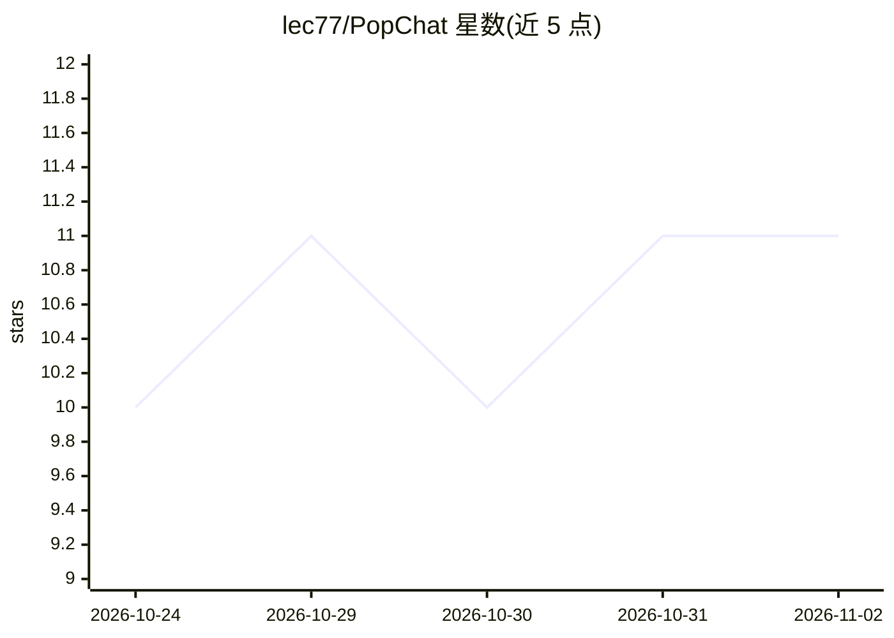

# lec77/PopChat

⭐ 11 · Swift · MIT · 推送 2026-09-18 · [GitHub](https://github.com/lec77/PopChat) · 个人维护

**macOS 菜单栏 AI 快聊浮窗，接任意 OpenAI 兼容模型**

原生 Swift + SwiftUI 编写的 macOS 菜单栏应用：全局热键唤出非激活式悬浮聊天面板，不抢底层应用焦点。支持任意 OpenAI 兼容端点（OpenAI、OpenRouter、自定义）及 Ollama/LM Studio 本地模型（无需 API key），另提供两种 ChatGPT 订阅接入预设（其中直连 OAuth 路径为非官方，作者声明可能失效且有账号风险）。功能含斜杠命令提示模板、推理过程查看、全文搜索、钉住面板。安装方式为 Releases 下载 DMG 或 SwiftPM 源码构建；要求 macOS 14+。版本 0.1.3，按个人用途以 as-is 形式分享，明确不做模型控制的代码执行、任意工具插件、语音与多窗口。

## 筛选速览

| 维度 | 判定 | 备注 |
|---|---|---|
| AI 角色 | `ai-native` | 本体是模型或模型工具 |
| 许可风险 | `permissive` | MIT |
| 部署形态 | `desktop` | 安装包/桌面程序 |
| 模型依赖 | local-ok | 支持本地模型 |
| 硬件要求 | — | 无带数字的原话,不猜 |
| 安装摩擦 | `low` | 无编译、无系统依赖或容器化 |
| 成熟度 | `idea` | |

## 能力要点

- 全局热键唤出的非激活 NSPanel 浮动聊天面板，不抢焦点
- 支持任意 OpenAI 兼容端点与 Ollama/LM Studio 本地模型（免 API key）
- 斜杠命令提示模板、推理思考过程折叠展示、跨会话全文搜索
- Releases 提供 Developer-ID 签名并公证的 DMG，更新检查只提示不自动安装

## 适用场景

- 写代码或写作时快速唤出小窗向轻量模型提问
- 搭配本地 Ollama/LM Studio 模型做免 key 日常问答
- 用斜杠命令快速套用自定义提示模板

## 场景标签

`AI 助手` `聊天机器人` · 领域:对话与助手

## 证据(README 行号)

> L7: A mini AI chat app for quick, small (and usually temporary) chats — the kind that don't need a frontier model, so it
> L16: - **Any OpenAI-compatible provider** — OpenAI, OpenRouter, or any custom endpoint, plus local models via Ollama or 

## 星数曲线

2026-10-24 10 → 2026-11-02 11（+1）

---
*卡片 v1 · prompt 1.4 · 生成 2026-11-02 · 置信度 high · 依据 README sha `ea37798009ea` · [字段定义](../../DATASET.md)*
