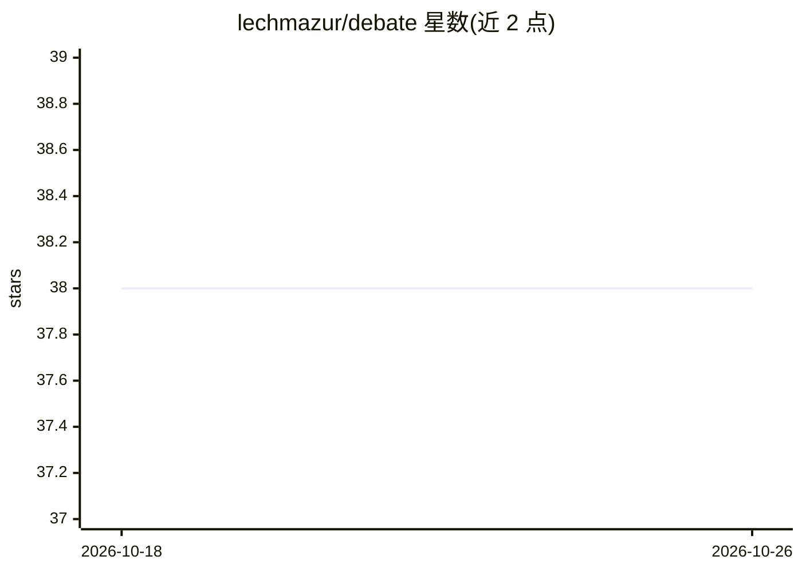

# lechmazur/debate

⭐ 38 · 推送 2026-10-17 · [GitHub](https://github.com/lechmazur/debate) · 个人维护

**LLM 多轮对抗辩论基准：换边对局+多模型评审排名模型**

面向 LLM 的对抗性多轮辩论评测基准：每场对局在同一辩题下交换正反方进行两场辩论，由三模型评审组裁决胜负与分差，基于完整换边对局构建 Bradley-Terry 排行榜（Glicko-2 为辅助诊断）。当前含 62 个受评模型、4,223 组换边对局、25,896 条评审判定、683 个辩题；另提供价格-性能对比、评审一致性热图与模型自评实验。README 以图表与报告形式呈现结果，未给出本基准的安装运行命令。

## 筛选速览

| 维度 | 判定 | 备注 |
|---|---|---|
| AI 角色 | `ai-ecosystem` | LLM/agent 周边工具 |
| 许可风险 | `none` | — |
| 部署形态 | `None` |  |
| 模型依赖 | — | README 未给出锁定关系 |
| 硬件要求 | — | 无带数字的原话,不猜 |
| 安装摩擦 | `low` | 无编译、无系统依赖或容器化 |
| 成熟度 | — | 结构信号不足 |

## 能力要点

- 同辩题正反方互换的换边对局设计（4,223 组、8,446 场辩论）
- 三模型评审组 + Bradley-Terry 评分（Glicko-2 为辅助诊断）
- 覆盖 62 个受评模型、683 个辩题的公开排行榜
- 评审一致性（decisive-only 0.938）与每场辩论美元成本核算

## 适用场景

- 查各大模型在多轮对抗辩论下的 Bradley-Terry 排名
- 对比模型的辩论成本与性能关系
- 检查评审组一致性与自评偏向等基准质量诊断

## 场景标签

`模型评测` · 领域:评测与运维

## 证据(README 行号)

> L1: # LLM Debate Benchmark: Adversarial Multi-Turn Argument Under Opposition
> L5: Each matchup runs twice on the **same motion with sides swapped**. A three-model judge panel decides each debate's w

## 星数曲线

2026-10-18 38 → 2026-10-26 38（+0）

---
*卡片 v1 · prompt 1.4 · 生成 2026-10-25 · 置信度 high · 依据 README sha `b7122e53f821` · [字段定义](../../DATASET.md)*
