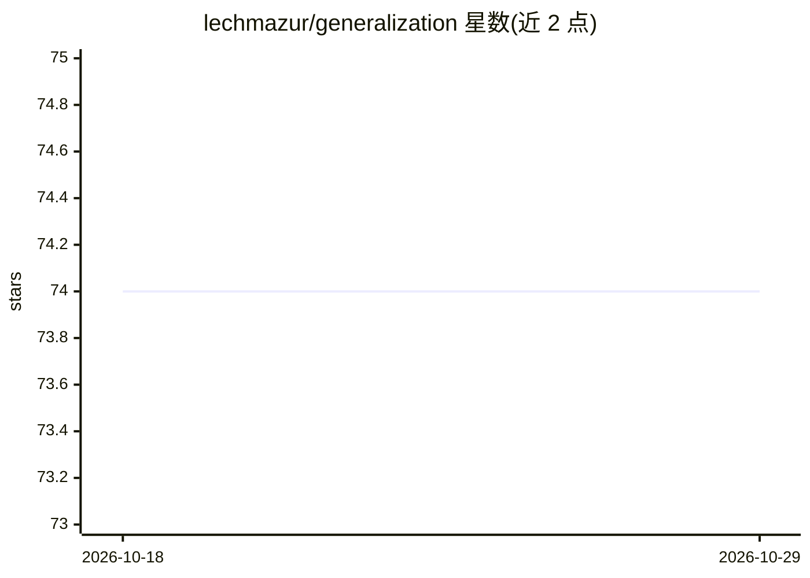

# lechmazur/generalization

⭐ 74 · 推送 2026-04-16 · [GitHub](https://github.com/lechmazur/generalization) · 个人维护

**测 LLM 从少量示例推断潜在主题能力的基准（1,247 题）**

面向 LLM 的主题泛化基准 V2：每题给出 3 个正例、3 个反例（贴合更宽泛但错误的模式）和 8 个候选（其中 1 个为真正匹配），考察模型能否推断出狭窄的潜在机制并在近似干扰项中选出唯一正确答案，以 Top-1 准确率与逆排名计分。V2 含 1,247 道经校验的题目，并发布 703 题跨家族困难子集与 881 题保守困难子集的排行榜，覆盖 30 个模型变体（Anthropic/OpenAI/Google/GLM/DeepSeek 等）。题目由多个 LLM 生成并经其他模型交叉校验与歧义筛查。README 未提供安装或运行方式，仅展示数据与结果；上一版 V1 归档。

## 筛选速览

| 维度 | 判定 | 备注 |
|---|---|---|
| AI 角色 | `ai-ecosystem` | LLM/agent 周边工具 |
| 许可风险 | `none` | — |
| 部署形态 | `None` |  |
| 模型依赖 | — | README 未给出锁定关系 |
| 硬件要求 | — | 无带数字的原话,不猜 |
| 安装摩擦 | `low` | 无编译、无系统依赖或容器化 |
| 成熟度 | — | 结构信号不足 |

## 能力要点

- 每题 3 正例 + 3 反例 + 8 候选（唯一真匹配）的题目格式
- V2 含 1,247 道校验题目与 703 题跨家族困难子集
- 逆排名（inverse-rank）计分与模型行为相关性热图
- 30 个模型变体的困难子集排行榜

## 适用场景

- 对比不同 LLM 在窄主题推断与抗干扰选上的能力
- 研究推理档位（reasoning）对泛化任务表现的影响
- 分析模型间在同一题目集上的错误模式聚类

## 场景标签

`模型评测` · 领域:评测与运维

## 证据(README 行号)

> L3: This benchmark tests whether large language models can infer a **specific latent theme** from a few examples, use an
> L10: Models score all 8 candidates. We then measure whether the correct candidate is ranked first, and how highly it ten
> L35: |Rank|Model|Top-1 Accuracy|Inverse-Rank Score|Cases|

## 星数曲线

2026-10-18 74 → 2026-10-29 74（+0）

---
*卡片 v1 · prompt 1.4 · 生成 2026-10-24 · 置信度 high · 依据 README sha `35ee1c3d735c` · [字段定义](../../DATASET.md)*
