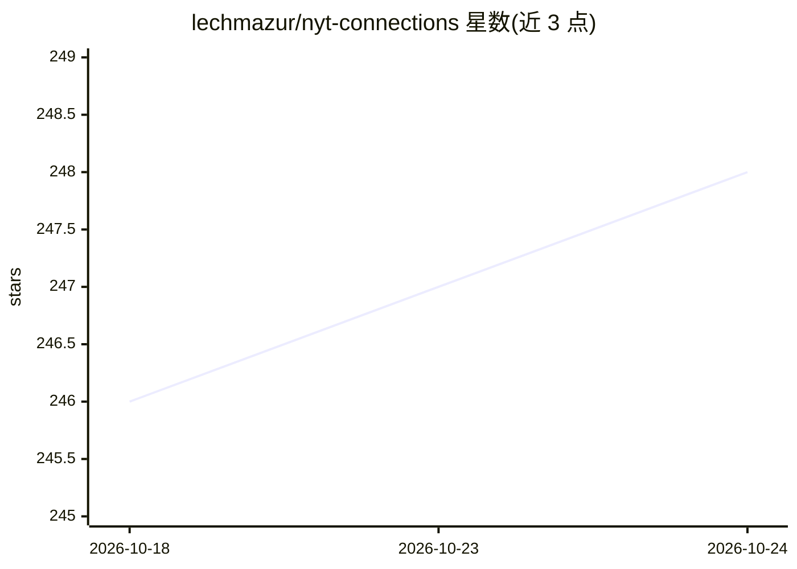

# lechmazur/nyt-connections

⭐ 248 · Python · 推送 2026-10-20 · [GitHub](https://github.com/lechmazur/nyt-connections) · 个人维护

**基于 NYT Connections 谜题的 LLM 言语联想推理评测基准**

使用 940 个纽约时报 Connections 谜题评测大语言模型：在标准谜题上每题追加至多四个干扰词（已验证不落入任何原分类）以提高难度，考察词汇与文化知识、双关识别、全局约束求解与抗干扰能力。计分采用 quadratic-v1 规则（按完全命中的分组数平方取均），主榜仅收录完成全部 940 题的模型，另有仅含最新 100 题的子榜以对冲训练数据泄漏可能，并附模型家族进展、成本-性能、题级相关性等图表。README 自述它不是通用智力的全面度量。

## 筛选速览

| 维度 | 判定 | 备注 |
|---|---|---|
| AI 角色 | `ai-ecosystem` | LLM/agent 周边工具 |
| 许可风险 | `none` | — |
| 部署形态 | `None` |  |
| 模型依赖 | — | README 未给出锁定关系 |
| 硬件要求 | — | 无带数字的原话,不猜 |
| 安装摩擦 | `low` | 无编译、无系统依赖或容器化 |
| 成熟度 | — | 结构信号不足 |

## 能力要点

- 940 题扩展版谜题，每题追加至多 4 个经验证不落入原分类的干扰词
- quadratic-v1 计分：(g/4)² 按题取均
- 最新 100 题子榜用于对冲训练数据含答案的情况
- 附带模型家族进展、引入日期-得分、成本-性能与相关性热图

## 适用场景

- 比较各 LLM 在言语联想推理上的表现
- 跟踪同一模型家族随时间的得分变化
- 结合每题成本数据做性价比参考

## 场景标签

`模型评测` · 领域:评测与运维

## 证据(README 行号)

> L3: This benchmark evaluates large language models (LLMs) using 940 NYT Connections puzzles, with additional words inclu
> L7: It is a focused test of verbal associative reasoning under combinatorial
> L13: Headline results use quadratic-v1 scoring: a puzzle with `g` exact groups

## 星数曲线

2026-10-18 246 → 2026-10-24 248（+2）

---
*卡片 v1 · prompt 1.4 · 生成 2026-10-22 · 置信度 high · 依据 README sha `cc3c8dc750b1` · [字段定义](../../DATASET.md)*
