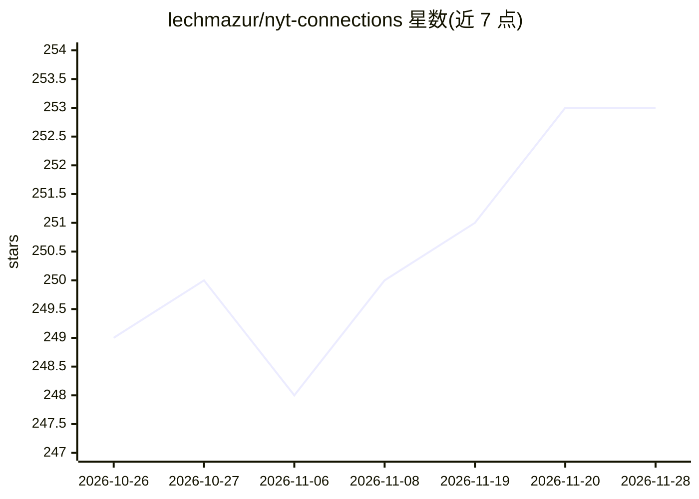

# lechmazur/nyt-connections

⭐ 253 · Python · 推送 2026-11-18 · [GitHub](https://github.com/lechmazur/nyt-connections) · 个人维护

**用 940 道扩展版 NYT Connections 谜题评测 LLM 的基准**

以《纽约时报》Connections 字词分组谜题为基础的 LLM 评测基准：每题额外加入最多 4 个经验证不落入原类别的干扰词，考察词汇联想、文字游戏识别与抗诱饵能力。采用 quadratic-v1 计分（精确分组数的平方占比），公布 940 题全量完成的模型排行榜与模型代际对比、单题成本估算、按发布日期与成本的散点图，并声明该基准不测软件工程等技能、不作为通用智能的综合度量。

## 筛选速览

| 维度 | 判定 | 备注 |
|---|---|---|
| AI 角色 | `ai-ecosystem` | LLM/agent 周边工具 |
| 许可风险 | `none` | — |
| 部署形态 | `None` |  |
| 模型依赖 | — | README 未给出锁定关系 |
| 硬件要求 | — | 无带数字的原话,不猜 |
| 安装摩擦 | `low` | 无编译、无系统依赖或容器化 |
| 成熟度 | — | 结构信号不足 |

## 能力要点

- 940 道谜题，每题最多加 4 个不落入原类别的干扰词
- quadratic-v1 计分：0/1/2/3/4 组对应 0%/6.25%/25%/56.25%/100%
- 排行榜、代际对比、成本估算与模型家族进度图表
- 主榜仅收录完成全部 940 题的模型

## 适用场景

- 对比各 LLM 在词汇联想推理任务上的表现
- 追踪同一模型家族不同版本的分数进展
- 结合标准定价估算模型跑完基准的成本

## 场景标签

`模型评测` · 领域:评测与运维

## 证据(README 行号)

> L3: This benchmark evaluates large language models (LLMs) using 940 NYT Connections puzzles, with additional words inclu
> L5: To increase difficulty compared to standard NYT Connections puzzles, Extended Connections adds up to four extra tric

## 星数曲线

2026-10-26 249 → 2026-11-28 253（+4）

---
*卡片 v1 · prompt 1.4 · 生成 2026-11-26 · 置信度 mid · 依据 README sha `d330b8d64e85` · [字段定义](../../DATASET.md)*
