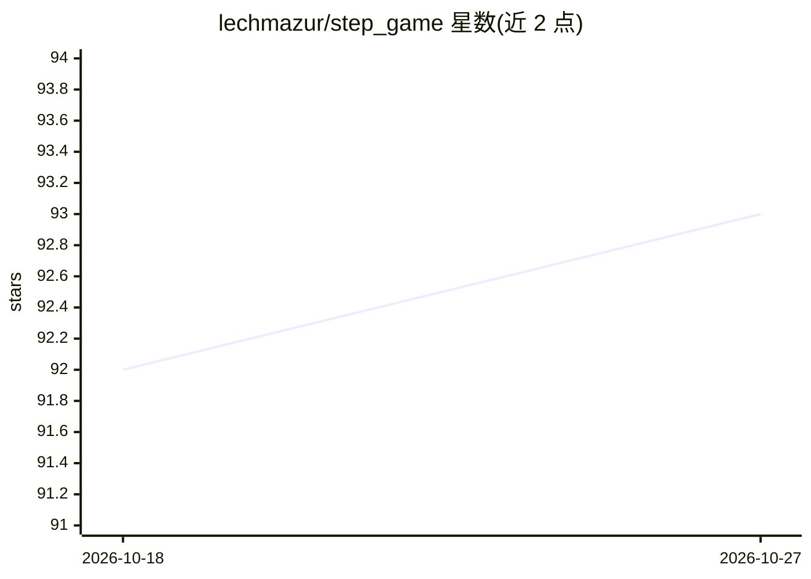

# lechmazur/step_game

⭐ 93 · 推送 2025-12-09 · [GitHub](https://github.com/lechmazur/step_game) · 个人维护

**多智能体赛跑基准：评测 LLM 博弈中的协作与欺骗**

三玩家“步数竞赛”基准：每局 3 个 LLM 进行多轮公开对话后同时秘密选择 1/3/5 步，选择相同数字的玩家发生碰撞不得前进，率先达到 16–24 步者获胜。评测考察模型的社会推理、结盟与欺骗行为，覆盖 75 个参赛者（含多个前沿模型与 7 个不对话的静默策略基线），通过 TrueSkill 排名、PvP 胜率矩阵、碰撞率、移动分布与发言长度等指标呈现 5185 场比赛的结果，并生成逐帧与摘要回放动画。Gemini QwQ 类长思维链输出经 DeepSeek-V3 清洗以保持文本简洁。面向 LLM 评测研究人员；README 未给出安装运行命令。

## 筛选速览

| 维度 | 判定 | 备注 |
|---|---|---|
| AI 角色 | `ai-ecosystem` | LLM/agent 周边工具 |
| 许可风险 | `none` | — |
| 部署形态 | `None` |  |
| 模型依赖 | — | README 未给出锁定关系 |
| 硬件要求 | — | 无带数字的原话,不猜 |
| 安装摩擦 | `low` | 无编译、无系统依赖或容器化 |
| 成熟度 | — | 结构信号不足 |

## 能力要点

- 三玩家对话+秘密选步机制，碰撞即停滞，考验协作与欺骗
- 75 个参赛者 5185 场比赛的 TrueSkill 排行榜与 PvP 矩阵
- 7 种静默策略基线（Random/Greedy/EVMax/UCB/Collision Tracker/Closer/Blocker）用于对照对话的影响
- 逐帧与摘要回放动画及碰撞率、移动分布、词长等可视化

## 适用场景

- 评测 LLM 在博弈情境下的合作、谈判与欺骗行为
- 比较不同前沿模型的多智能体社交推理能力
- 研究对话信号对对手下一步选择的预测价值

## 场景标签

`多智能体` `模型评测` · 领域:Agent 开发

## 证据(README 行号)

> L1: # Multi-Agent Step Race Benchmark: Assessing LLM Collaboration and Deception Under Pressure
> L74: ## LLM Step-Game Leaderboard
> L76: **Matches**: 5185, repeated in 500 random permutations.

## 星数曲线

2026-10-18 92 → 2026-10-27 93（+1）

---
*卡片 v1 · prompt 1.4 · 生成 2026-10-23 · 置信度 high · 依据 README sha `e6b3d1789e5f` · [字段定义](../../DATASET.md)*
