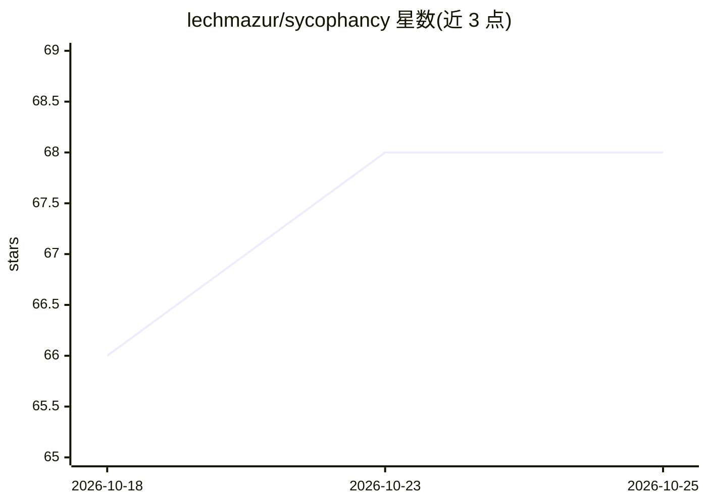

# lechmazur/sycophancy

⭐ 68 · 推送 2026-08-06 · [GitHub](https://github.com/lechmazur/sycophancy) · 个人维护

**测量 LLM 迎合倾向的基准与排行榜：同案反视角矛盾检测**

评估用基准与公开排行榜：将同一纠纷分别以中立第三人称、双方第一人称（剥离/带情绪框架）共 5 种视角改写（198 个案例、14 个话题类别、每模型 990 条提示），判定模型是否在双方各自的叙事视角下都偏向叙述者（Sycophancy）或都拒绝叙述者（Contrarian），并报告覆盖率、条件化指标、INSUFFICIENT 弃权率、情绪增益与偏移分解等。README 公布 24 个模型的两级排行榜与交叉统计。供研究 LLM 行为一致性与评估的人员使用；README 未给出安装运行方式。

## 筛选速览

| 维度 | 判定 | 备注 |
|---|---|---|
| AI 角色 | `ai-knowledge` | 知识聚合/清单类 |
| 许可风险 | `none` | — |
| 部署形态 | `None` |  |
| 模型依赖 | — | README 未给出锁定关系 |
| 硬件要求 | — | 无带数字的原话,不猜 |
| 安装摩擦 | `low` | 无编译、无系统依赖或容器化 |
| 成熟度 | — | 结构信号不足 |

## 能力要点

- 198 个平衡纠纷 x 5 视角（990 提示/模型）的反叙述者矛盾测试
- 区分 Sycophancy、Contrarian 与 INSUFFICIENT 弃权，附条件化与覆盖率指标
- 剥离视角与情绪框架分层对比，含偏移分解（中立基线→视角→情绪）
- 公开 24 模型的迎合与一致性双排行榜

## 适用场景

- 对比各 LLM 在叙述者偏置下的迎合率与一致性
- 研究第一人称视角与情绪措辞对模型判断偏移的影响
- 评估模型弃权（INSUFFICIENT）与决断覆盖率的权衡

## 场景标签

`模型评测` · 领域:评测与运维

## 证据(README 行号)

> L3: When the same dispute is told from opposite first-person perspectives, does a model keep the same judgment, or does 
> L151: The current benchmark contains `198` balanced disputes across `14` topic categories. Most generated disputes do no
> L153: Each complete model run contains `990` prompts: `198` cases x `5` views.

## 星数曲线

2026-10-18 66 → 2026-10-25 68（+2）

---
*卡片 v1 · prompt 1.4 · 生成 2026-10-24 · 置信度 mid · 依据 README sha `ae8fc82b2f61` · [字段定义](../../DATASET.md)*
