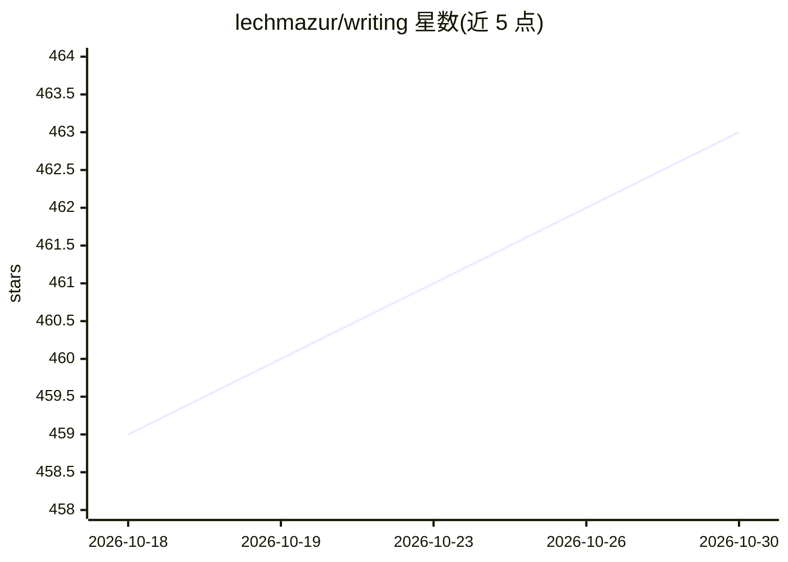

# lechmazur/writing

⭐ 463 · 推送 2026-10-24 · [GitHub](https://github.com/lechmazur/writing) · 个人维护

**LLM 创意写作评测基准：59 个模型故事对比排行**

对多个 LLM 在相同约束创意简报下生成的短故事做对比评测：每个简报强制纳入角色、物品、动机、语气等 10 项必需要素，评估模型按两种阅读顺序成对判优，经 Thurstone 统计模型（含呈现顺序校正）汇总为相对分数与 95% bootstrap 区间。当前覆盖 59 个写作模型、977 组直接配对、16,552 个故事对、110,748 次判断。仓库公开故事提示词（prompts_wc/）、生成故事（stories_wc/）及机读排行榜数据，供研究者和模型选型者查阅。

## 筛选速览

| 维度 | 判定 | 备注 |
|---|---|---|
| AI 角色 | `ai-knowledge` | 知识聚合/清单类 |
| 许可风险 | `none` | — |
| 部署形态 | `None` |  |
| 模型依赖 | — | README 未给出锁定关系 |
| 硬件要求 | — | 无带数字的原话,不猜 |
| 安装摩擦 | `low` | 无编译、无系统依赖或容器化 |
| 成熟度 | — | 结构信号不足 |

## 能力要点

- 59 个写作模型、110,748 次评估判断的对比排行
- 每个故事强制融合 10 项必需要素的固定简报设计
- Thurstone 统计模型 + 呈现顺序校正 + bootstrap 区间
- 公开提示词、生成故事与机读排行数据

## 适用场景

- 查阅各 LLM 在约束创意写作任务上的相对表现
- 获取带必需要素的创意写作提示词与多模型故事语料
- 比较新旧版本模型（如 Gemini 4 Argon vs 3.1 Pro）的写作差异

## 场景标签

`模型评测` · 领域:评测与运维

## 证据(README 行号)

> L3: This benchmark compares short stories written to the same constrained creative briefs. Separate evaluator models rea
> L168: Story prompts are available under `prompts_wc/`, and generated stories under `stories_wc/<model>/`.
> L170: Current ratings and chart data include machine-readable leaderboard scores and uncertainty intervals, direct head-

## 星数曲线

2026-10-18 459 → 2026-10-30 463（+4）

---
*卡片 v1 · prompt 1.4 · 生成 2026-10-22 · 置信度 mid · 依据 README sha `b7a673005005` · [字段定义](../../DATASET.md)*
