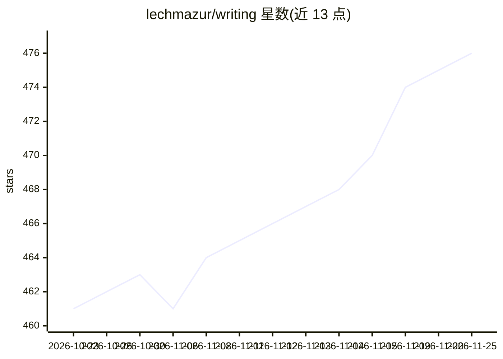

# lechmazur/writing

⭐ 476 · 推送 2026-11-17 · [GitHub](https://github.com/lechmazur/writing) · 个人维护

**LLM 短篇创意写作基准：约束要素写作的成对盲评排行榜**

该仓库是一个创意写作评测基准：向各写作模型发出相同的受约束写作简报（要求纳入 10 项指定故事要素），由独立评估模型以两种顺序成对阅读并判定优劣，汇总为相对分数、胜率估计与 95% bootstrap 区间。当前结果覆盖 67 个写作模型、20,589 组故事对、134,964 条判定，另附评估者一致性矩阵与字数合规统计。README 主体为结果展示，评测运行方式在可见行号之外。

## 筛选速览

| 维度 | 判定 | 备注 |
|---|---|---|
| AI 角色 | `ai-knowledge` | 知识聚合/清单类 |
| 许可风险 | `none` | — |
| 部署形态 | `None` |  |
| 模型依赖 | — | README 未给出锁定关系 |
| 硬件要求 | — | 无带数字的原话,不猜 |
| 安装摩擦 | `low` | 无编译、无系统依赖或容器化 |
| 成熟度 | — | 结构信号不足 |

## 能力要点

- 67 个写作模型、20,589 组故事对、134,964 条成对判定
- 双顺序盲评与 bootstrap 重采样给出分数区间
- 要素约束型简报：每篇须纳入 10 项指定故事要素
- 附评估者一致性矩阵与 600–800 字合规统计

## 适用场景

- 比较各模型在受约束创意写作任务上的表现
- 查看特定模型之间的成对对比结果
- 了解评估模型之间判定一致性的差异

## 场景标签

`模型评测` · 领域:评测与运维

## 证据(README 行号)

> L1: # LLM Creative Story-Writing Benchmark
> L3: This benchmark compares short stories written to the same constrained creative briefs. Separate evaluator models rea
> L11: The ranking combines judgments from earlier and newer evaluator models. It covers **67 writer models**, **1,167 dir

## 星数曲线

2026-10-23 461 → 2026-11-25 476（+15）

---
*卡片 v1 · prompt 1.4 · 生成 2026-11-25 · 置信度 high · 依据 README sha `dd1508d34310` · [字段定义](../../DATASET.md)*
