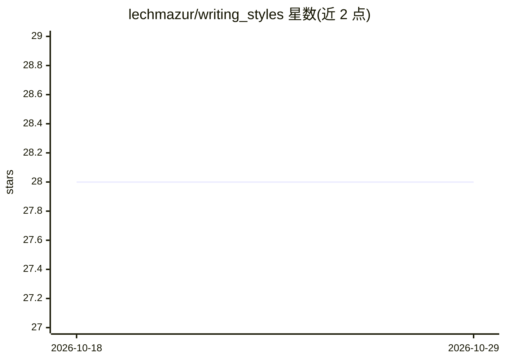

# lechmazur/writing_styles

⭐ 28 · 推送 2025-12-18 · [GitHub](https://github.com/lechmazur/writing_styles) · 个人维护

**短篇创意写作 LLM 基准的风格侧研究文档：模型风格指纹与多样性分析**

记录创意写作基准的风格维度：用 29 个 LLM 各生成至少 400 篇 600–800 词闪小说（共 15,347 篇），由独立评审模型沿语音、句法、POV、结构、意象、对话、实验性、收尾等轴打分，形成每模型风格指纹；并以加权 Gower 距离计算模型内部多样性排行（GPT-5 medium reasoning 0.218 最高，GPT-OSS-120B 0.171 最低）。文档声明多样性分数非质量评级，且结果基于中性提示词，定向提示可改变风格。面向关心 LLM 创意写作输出的研究者与选型者。

## 筛选速览

| 维度 | 判定 | 备注 |
|---|---|---|
| AI 角色 | `ai-knowledge` | 知识聚合/清单类 |
| 许可风险 | `none` | — |
| 部署形态 | `None` |  |
| 模型依赖 | — | README 未给出锁定关系 |
| 硬件要求 | — | 无带数字的原话,不猜 |
| 安装摩擦 | `low` | 无编译、无系统依赖或容器化 |
| 成熟度 | — | 结构信号不足 |

## 能力要点

- 29 个模型、15,347 篇故事的风格打分与聚合
- 加权 Gower 模型内多样性排行榜（0–1）
- 数值轴（0–10）与枚举轴（时态、场景、句式等）双类指纹
- 声明非质量评级、结果限于中性提示词条件

## 适用场景

- 我想了解各 LLM 在创意写作上的风格倾向与多样性差异
- 为创意写作应用选型时参考模型的风格指纹
- 比较模型在对话量、实验性、结尾类型等维度的分布

## 场景标签

`模型评测` · 领域:评测与运维

## 证据(README 行号)

> L3: This writeup documents the **style** side of the short-story Creative Writing LLM benchmark: we generated many short
> L10: We asked models to write **flash-fiction pieces of 600–800 words** from the same pool of prompts so comparisons are

## 星数曲线

2026-10-18 28 → 2026-10-29 28（+0）

---
*卡片 v1 · prompt 1.4 · 生成 2026-10-26 · 置信度 high · 依据 README sha `4ddedea8a757` · [字段定义](../../DATASET.md)*
