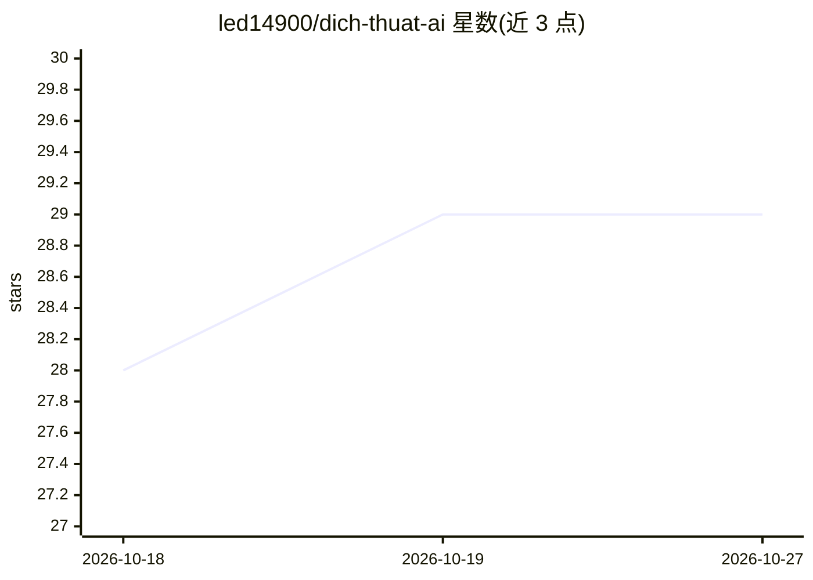

# led14900/dich-thuat-ai

⭐ 29 · JavaScript · 推送 2026-09-23 · [GitHub](https://github.com/led14900/dich-thuat-ai) · [官网](https://tapgo10ngon.com) · 个人维护

**Windows 桌面 PDF 翻译工具：AI 逐页翻译并保留排版**

面向 Windows 用户的桌面应用：拖入 PDF 后将每页转为图片发送给视觉模型翻译，保留标题、表格、列表等结构，支持 Gemini Enterprise Agent Platform、Gemini API（Google AI Studio）及任意 OpenAI Compatible endpoint（OpenRouter/Groq/DeepSeek/本地 Ollama/LM Studio/vLLM 等）。提供 17 个专业领域 prompt 模板、双语对照（穿插/两栏）与纯译文输出，可导出 Markdown 或 Word，自动记录历史与 token/费用统计。提供 portable 免安装 exe 与安装包两种二进制，未签名会触发 SmartScreen 警告。

## 筛选速览

| 维度 | 判定 | 备注 |
|---|---|---|
| AI 角色 | `ai-native` | 本体是模型或模型工具 |
| 许可风险 | `none` | — |
| 部署形态 | `desktop` | 安装包/桌面程序 |
| 模型依赖 | local-ok | 支持本地模型 |
| 硬件要求 | — | 无带数字的原话,不猜 |
| 安装摩擦 | `low` | 无编译、无系统依赖或容器化 |
| 成熟度 | — | 结构信号不足 |

## 能力要点

- 页面转图片发送视觉模型翻译，保留原文档结构
- 三种接入方式：Gemini Enterprise / Gemini API / OpenAI Compatible endpoint
- 17 个专业领域 prompt 模板（医学、法律、物流等）
- 双语对照（穿插/两栏）输出，导出 Markdown 或 Word，含费用/ token 统计

## 适用场景

- 把英文 PDF 文档翻译成中文并保留排版
- 对照阅读原文与译文（双语两栏模式）
- 用本地模型（Ollama/vLLM）离线翻译 PDF

## 场景标签

 · 领域:文档翻译/桌面工具

## 证据(README 行号)

> L3: AI Translate là ứng dụng desktop cho Windows giúp dịch thuật tự động các tài liệu PDF dựa trên công nghệ AI tiên tiế
> L68: 4. Chọn model **nhận được ảnh (vision)** — app gửi từng trang PDF dưới dạng ảnh, model chỉ đọc văn bản sẽ không dịc
> L80: - 📄 **Dịch thuật PDF chuyên nghiệp:** Kéo thả trực tiếp file PDF để tải lên và bắt đầu dịch.

## 星数曲线

2026-10-18 28 → 2026-10-27 29（+1）

---
*卡片 v1 · prompt 1.4 · 生成 2026-10-26 · 置信度 high · 依据 README sha `080d53b02485` · [字段定义](../../DATASET.md)*
