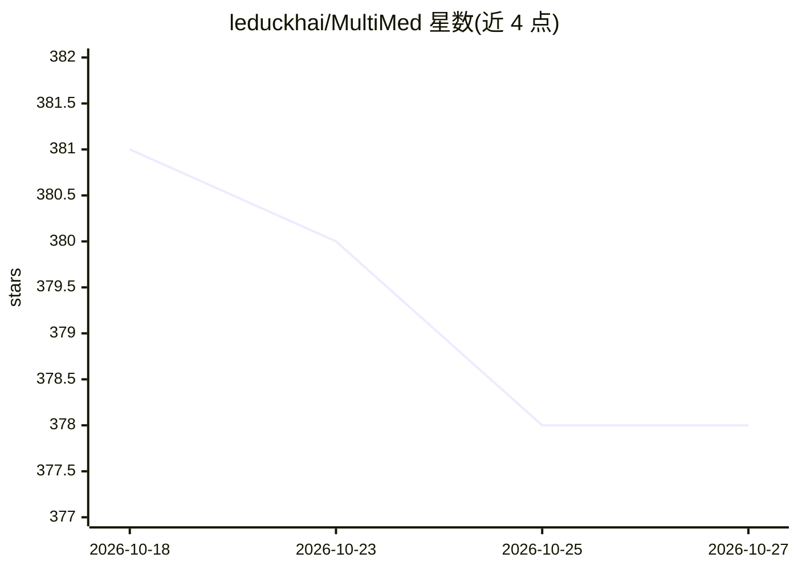

# leduckhai/MultiMed

⭐ 378 · Python · 推送 2026-10-19 · [GitHub](https://github.com/leduckhai/MultiMed) · 个人维护

**医学领域多语言多任务语音处理系列论文的代码与数据集合集**

由多伦多大学 Le-Duc Khai 维护的研究代码库，汇集医学语音处理方向 4 篇已发表论文（LREC-COLING 2024、Interspeech 2024、NAACL 2025、ACL 2025）的代码、数据集与模型：越南语医学 ASR 数据集 VietMed（16h 标注+1000h 无标注医学语音）、医学口语 NER 数据集 VietMed-NER（18 种实体类型）、医学对话实时语音摘要系统与数据集 VietMed-Sum、覆盖 5 种语言的多语言医学 ASR 数据集 MultiMed 及配套端到端模型。各子项目分别指向仓库子目录，README 未给出安装运行命令。

## 筛选速览

| 维度 | 判定 | 备注 |
|---|---|---|
| AI 角色 | `ai-native` | 本体是模型或模型工具 |
| 许可风险 | `none` | — |
| 部署形态 | `None` |  |
| 模型依赖 | — | README 未给出锁定关系 |
| 硬件要求 | — | 无带数字的原话,不猜 |
| 安装摩擦 | `low` | 无编译、无系统依赖或容器化 |
| 成熟度 | — | 结构信号不足 |

## 能力要点

- VietMed：16h 标注+1000h 无标注越南语医学语音数据集及预训练/微调模型
- VietMed-NER：18 种实体类型的医学口语 NER 数据集
- VietMed-Sum：医学对话实时语音摘要系统与数据集（含 LLM+人工标注）
- MultiMed：覆盖越/英/德/法/中 5 语言的医学 ASR 数据集与模型

## 适用场景

- 下载医学语音数据集训练或评测 ASR/NER/摘要模型
- 复现论文中的基线结果与多语言医学 ASR 实验
- 获取越南语医学语音的预训练与微调模型

## 场景标签

`语音识别` `模型训练` · 领域:感知与多模态

## 证据(README 行号)

> L14: Due to privacy restrictions, there's a shortage of publicly available speech recognition datasets in the medical do
> L69: Multilingual automatic speech recognition (ASR) in the medical domain serves as a foundational task for various dow

## 星数曲线

2026-10-18 381 → 2026-10-27 378（-3）

---
*卡片 v1 · prompt 1.4 · 生成 2026-10-21 · 置信度 high · 依据 README sha `9490d1833487` · [字段定义](../../DATASET.md)*
