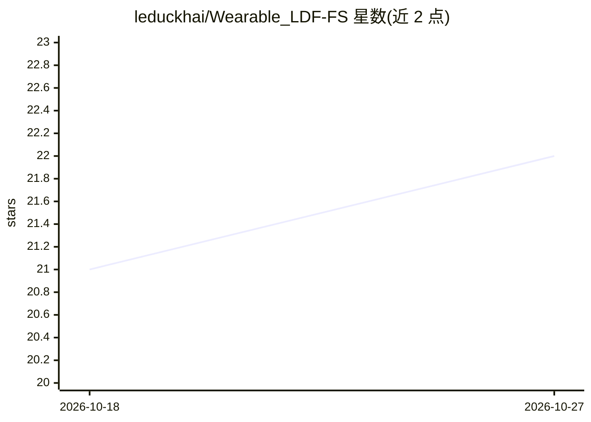

# leduckhai/Wearable_LDF-FS

⭐ 22 · Jupyter Notebook · NOASSERTION · 推送 2026-07-09 · [GitHub](https://github.com/leduckhai/Wearable_LDF-FS) · [官网](https://arxiv.org/abs/2502.00973) · 组织维护

**面向科研的 LDF+FS 可穿戴心理健康评估多模态数据集与基准**

配合论文发布的多模态数据集与机器学习基准：132 名成人（18–94 岁、19 国）的指尖激光多普勒血流仪（LDF）与荧光光谱（FS）测量数据，结合人口学、生活方式与 DASS-21 量表变量。仓库提供去标识化公开数据、预处理与分析 Jupyter 笔记本，覆盖二分类/多分类、受试者不交叉的 5 折交叉验证与留一受试者验证，以及 SHAP 特征归因分析。最佳报告结果为 LightGBM（ROC-AUC 0.7168）。README 声明 DASS-21 非临床诊断工具，模型输出仅限研究用途。

## 筛选速览

| 维度 | 判定 | 备注 |
|---|---|---|
| AI 角色 | `ai-knowledge` | 知识聚合/清单类 |
| 许可风险 | `none` | NOASSERTION |
| 部署形态 | `None` |  |
| 模型依赖 | — | README 未给出锁定关系 |
| 硬件要求 | — | 无带数字的原话,不猜 |
| 安装摩擦 | `low` | 无编译、无系统依赖或容器化 |
| 成熟度 | — | 结构信号不足 |

## 能力要点

- 132 名成人 LDF+FS 可穿戴数据，链接 DASS-21 量表评估
- 受试者不交叉交叉验证与留一受试者验证的泄漏防护评测
- SHAP 全局与个体级特征归因分析
- 提供预处理、分类与可解释性分析 Jupyter 笔记本

## 适用场景

- 研究可穿戴光学信号与压力相关心理状态的关联
- 在公开数据上复现或对比心理健康预测基准
- 开展生理信号分析与可解释机器学习研究

## 场景标签

`模型评测` `科研工具` · 领域:评测与运维

## 证据(README 行号)

> L16: We introduce a multimodal dataset collected with a wearable device that combines:
> L22: The repository provides the data and analysis notebooks used to study associations between these signals and stress
> L43: ### 1. A multimodal wearable dataset for mental-health research

## 星数曲线

2026-10-18 21 → 2026-10-27 22（+1）

---
*卡片 v1 · prompt 1.4 · 生成 2026-10-27 · 置信度 high · 依据 README sha `cb13ce75e378` · [字段定义](../../DATASET.md)*
