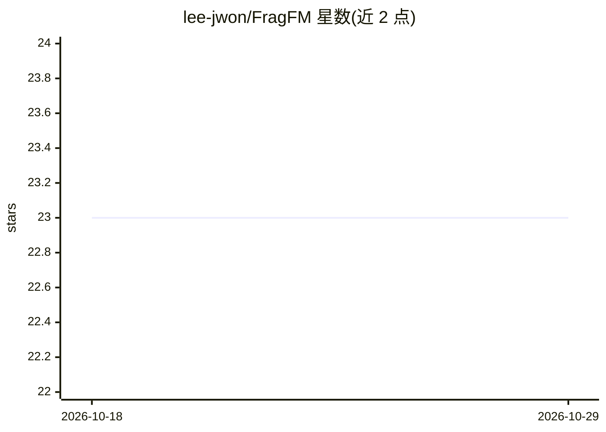

# lee-jwon/FragFM

⭐ 23 · Python · MIT · 推送 2026-04-24 · [GitHub](https://github.com/lee-jwon/FragFM) · [官网](https://openreview.net/forum?id=tr6vRn2aPg) · 组织维护

**片段级离散流匹配的分子图生成框架与天然产物基准**

ICLR 2026 论文 FragFM 的官方实现：通过随机片段袋与无损粗到细原子级重建，以层级离散流匹配生成分子图；支持条件生成（片段袋与图级预测器引导，可指定 logp/nring/tpsa/qed 等性质目标）。附 NPGen 基准，基于 COCONUT 数据库评估生成模型在天然产物化学空间的表型，对比 SAFE-GPT、GraphAF、DiGress、DeFoG、JT-VAE、HierVAE、MolHF 等基线。面向分子生成研究者，提供 MOSES/GuacaMol/ZINC250k/NPGen 的数据与 checkpoint；基准要求 RDKit 固定 2020.03.2 版本，ARM Mac 无法原生运行。

## 筛选速览

| 维度 | 判定 | 备注 |
|---|---|---|
| AI 角色 | `ai-native` | 本体是模型或模型工具 |
| 许可风险 | `permissive` | MIT |
| 部署形态 | `library` | 以包/库形式分发 |
| 模型依赖 | — | README 未给出锁定关系 |
| 硬件要求 | — | 无带数字的原话,不猜 |
| 安装摩擦 | `low` | 无编译、无系统依赖或容器化 |
| 成熟度 | — | 结构信号不足 |

## 能力要点

- 层级片段级离散流匹配 + 无损粗到细原子级重建生成分子图
- 条件生成：片段袋与图级性质预测器双引导（logp/nring/tpsa/qed）
- NPGen 天然产物生成基准（源自 COCONUT），含 8 个基线模型各 30,000 条 SMILES
- 提供四个数据集的预训练 checkpoint 与三种环境安装方式（conda/uv/pixi）

## 适用场景

- 训练与采样生成分分子，或按目标性质做条件分子生成
- 在天然产物化学空间上评估与对比生成模型
- 复现论文实验或作为片段级图生成研究的基线

## 场景标签

`模型训练` `模型评测` · 领域:评测与运维

## 证据(README 行号)

> L10: **FragFM** is a hierarchical fragment-level discrete flow matching framework that generates molecular graphs via st
> L141: FragFM offers a conditional molecule generation scheme with fragment-bag and graph-level predictor guidance.
> L179: **NPGen** is a large-scale natural product generation benchmark designed to evaluate generative models on structur

## 星数曲线

2026-10-18 23 → 2026-10-29 23（+0）

---
*卡片 v1 · prompt 1.4 · 生成 2026-10-27 · 置信度 mid · 依据 README sha `5d3354bbc3fb` · [字段定义](../../DATASET.md)*
