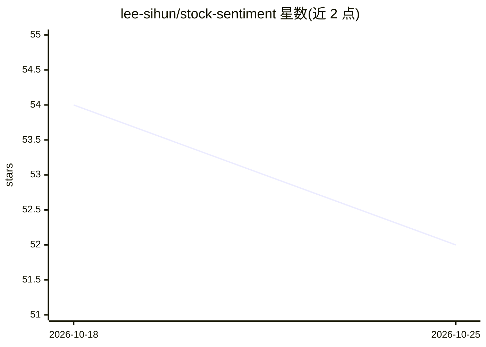

# lee-sihun/stock-sentiment

⭐ 52 · TypeScript · 推送 2025-12-13 · [GitHub](https://github.com/lee-sihun/stock-sentiment) · [官网](https://deepeye.pro) · 个人维护

**用 LLM 分析股票新闻情绪、提供实时股价的投资洞察服务**

DeepEye 是面向投资者的股票情绪分析 Web 服务：通过 Yahoo Finance API 获取实时股价，用 gemini-2.5-flash-lite 模型（经 OpenRouter 调用）对新闻标题做情绪分析并可视化。灵感来自 Lopez-Lira & Tang (2023) 关于 LLM 股价预测研究的论文。支持 Google OAuth 登录、Supabase 同步的自选股管理、自动补全的股票搜索；GitHub Actions 每日 22:00（KST）定时采集新闻并分析。前端 Next.js 15，部署于 Vercel。

## 筛选速览

| 维度 | 判定 | 备注 |
|---|---|---|
| AI 角色 | `ai-native` | 本体是模型或模型工具 |
| 许可风险 | `none` | — |
| 部署形态 | `None` |  |
| 模型依赖 | locked-api |  |
| 硬件要求 | — | 无带数字的原话,不猜 |
| 安装摩擦 | `low` | 无编译、无系统依赖或容器化 |
| 成熟度 | — | 结构信号不足 |

## 能力要点

- gemini-2.5-flash-lite 模型（OpenRouter 调用）分析新闻情绪
- Yahoo Finance API 实时股价数据
- 登录/非登录两种自选股管理（Supabase / LocalStorage）
- GitHub Actions 每日定时新闻采集与情绪分析

## 适用场景

- 查看个股新闻情绪分析结果辅助判断市场动向
- 管理自选股并跟踪实时股价
- 浏览个股详情与情绪分析可视化

## 场景标签

`金融量化` · 领域:学习与行业

## 证据(README 行号)

> L7: 주식의 뉴스 기사를 LLM으로 감정 분석하여 제공하는 투자 인사이트 서비스입니다.
> L18: - **LLM 기반 뉴스 분석**: gemini-2.5-flash-lite 모델을 활용한 뉴스 기사 감정 분석

## 星数曲线

2026-10-18 54 → 2026-10-25 52（-2）

---
*卡片 v1 · prompt 1.4 · 生成 2026-10-24 · 置信度 high · 依据 README sha `0d8f64c31f77` · [字段定义](../../DATASET.md)*
