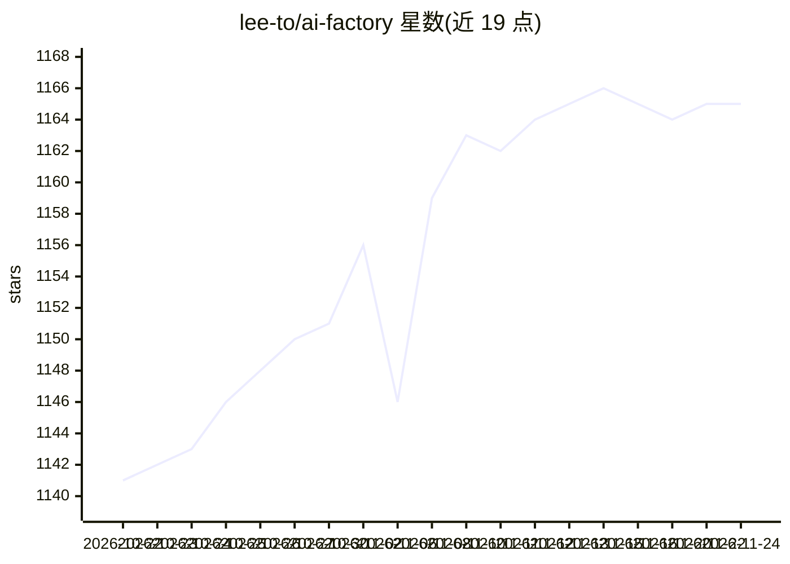

# lee-to/ai-factory

⭐ 1,165 · JavaScript · 推送 2026-11-19 · [GitHub](https://github.com/lee-to/ai-factory) · [官网](https://aif.cutcode.dev) · 个人维护

**为 AI 编程 agent 一键配置技能、提示与工作流的 CLI**

一个 npm 分发的 CLI 工具（ai-factory init），为 AI 编程 agent 搭建开发环境：交互式向导安装相关 skills、配置 MCP 服务器、生成 slash 命令，采用 spec-driven 开发流程（explore/grounded/plan/implement/fix/evolve 等）。支持 Claude Code、Cursor、Codex CLI、Gemini CLI 等多种 agent，语言与框架无关；技能可经 skills.sh 单独安装（仅技能文件，不含 CLI 与 MCP 配置）。MIT 许可。

## 筛选速览

| 维度 | 判定 | 备注 |
|---|---|---|
| AI 角色 | `ai-ecosystem` | LLM/agent 周边工具 |
| 许可风险 | `none` | — |
| 部署形态 | `library` | 以包/库形式分发 |
| 模型依赖 | — | README 未给出锁定关系 |
| 硬件要求 | — | 无带数字的原话,不猜 |
| 安装摩擦 | `low` | 无编译、无系统依赖或容器化 |
| 成熟度 | — | 结构信号不足 |

## 能力要点

- 一条命令安装技能、配置 MCP 与集成，支持交互与非交互（--agents/--mcp/--skills）模式
- spec-driven 开发工作流：explore、grounded、plan、fix、implement、evolve 等 slash 命令
- 支持 Claude Code、Cursor、Codex、Gemini CLI、GitHub Copilot 等多种 agent，栈无关
- reflex loop（生成→评估→批判→精炼）与技能自进化（/aif-fix 反哺 /aif-evolve）

## 适用场景

- 新项目中快速为团队选定的 AI agent 配置统一开发工作流
- 以 spec 驱动方式让 AI 按计划实现功能而非自由探索
- 仅安装 aif-* 技能文件到现有 agent 环境中

## 场景标签

 · 领域:开发者工具/AI 编程工作流

## 证据(README 行号)

> L29: - **Spec-driven development** — AI follows plans, not random exploration. Predictable, resumable, reviewable
> L32: - **Multi-agent support** — Claude Code, Cursor, Devin CLI, Devin Desktop (formerly Windsurf), Roo Code, Kilo Code,
> L39: npm install -g ai-factory

## 星数曲线

2026-10-22 1,141 → 2026-11-24 1,165（+24）

---
*卡片 v1 · prompt 1.4 · 生成 2026-11-23 · 置信度 high · 依据 README sha `71f92d362a96` · [字段定义](../../DATASET.md)*
