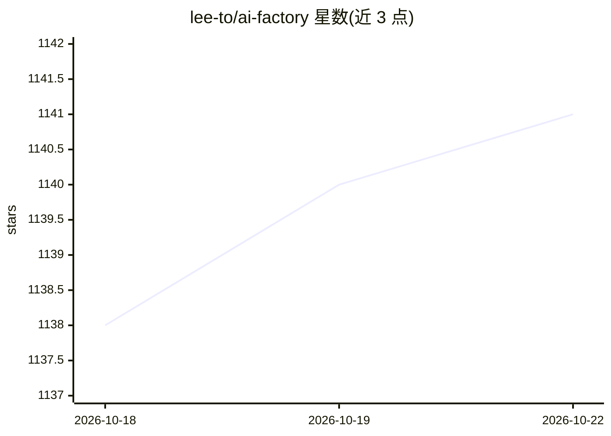

# lee-to/ai-factory

⭐ 1,142 · Shell · 推送 2026-10-15 · [GitHub](https://github.com/lee-to/ai-factory) · [官网](https://aif.cutcode.dev) · 个人维护

**一条命令为各类 AI 编程代理安装技能与配置的开发环境工具**

面向使用 AI 编程代理的开发者的 CLI 工具：通过 ai-factory init 交互式向导或命令行参数，安装 aif-* 技能集、配置 MCP 服务器与多种代理（Claude Code、Cursor、Codex、Gemini CLI 等）的集成，形成规范驱动（spec-driven）的开发工作流，包含 explore/plan/implement/fix/evolve 等斜杠命令。技能也可不经完整安装，单独经 skills.sh 用 npx skills 添加。以 npm 全局包分发，声明与语言/框架无关，MIT 许可。

## 筛选速览

| 维度 | 判定 | 备注 |
|---|---|---|
| AI 角色 | `ai-ecosystem` | LLM/agent 周边工具 |
| 许可风险 | `none` | — |
| 部署形态 | `library` | 以包/库形式分发 |
| 模型依赖 | — | README 未给出锁定关系 |
| 硬件要求 | — | 无带数字的原话,不猜 |
| 安装摩擦 | `low` | 无编译、无系统依赖或容器化 |
| 成熟度 | — | 结构信号不足 |

## 能力要点

- ai-factory init 一条命令安装技能、配置 MCP 与代理集成
- 支持 Claude Code、Cursor、Codex、Gemini CLI 等十余种代理
- 规范驱动开发流程：explore/plan/implement/fix/evolve 斜杠命令
- 技能可单独经 skills.sh 安装（npx skills add）

## 适用场景

- 为常用 AI 编程代理快速搭建技能与 MCP 配置
- 用规范驱动的计划-实现-修复流程组织 AI 辅助开发
- 只取用 aif-* 技能文件到已有环境

## 场景标签

`提示工程` · 领域:Agent 开发

## 证据(README 行号)

> L22: ai-factory init
> L32: - **Multi-agent support** — Claude Code, Cursor, Windsurf, Roo Code, Kilo Code, Antigravity 2.0, OpenCode, Warp, Ze
> L58: This will:

## 星数曲线

2026-10-18 1,138 → 2026-10-22 1,141（+3）

---
*卡片 v1 · prompt 1.4 · 生成 2026-10-21 · 置信度 high · 依据 README sha `4d7edf3f8dbc` · [字段定义](../../DATASET.md)*
