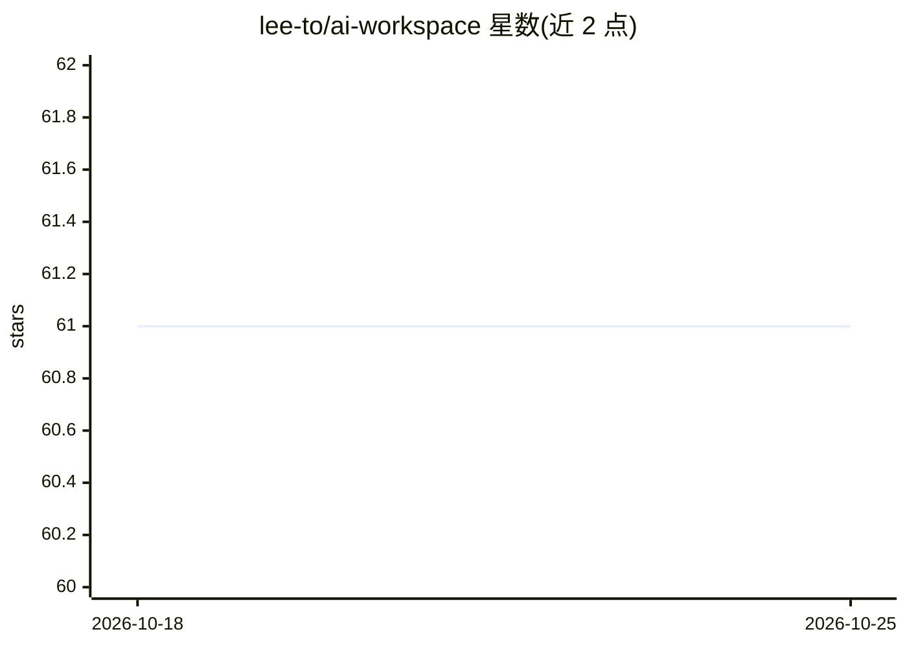

# lee-to/ai-workspace

⭐ 61 · Rust · MIT · 推送 2026-10-05 · [GitHub](https://github.com/lee-to/ai-workspace) · 个人维护

**跨项目共享上下文的 CLI + MCP 服务器，给 AI 编码代理记忆**

面向使用 Claude Code、Cursor、Windsurf 等 AI 编码代理的开发者：将相关项目组成组，在组内共享文件、目录与笔记，使代理自动获得跨项目上下文，无需复制粘贴或符号链接。以 Rust 编写，通过 cargo install 从源码安装，SQLite 已捆绑。默认暴露 17 个 MCP 工具；含 Rust-only 的 CodeGraph（索引符号与调用关系到 SQLite）；文件写入与全项目访问默认关闭，需环境变量显式开启；另有可选的 PostgreSQL 云同步与只读托管 MCP 端点；团队可通过提交 .ai-workspace.json 共享配置。

## 筛选速览

| 维度 | 判定 | 备注 |
|---|---|---|
| AI 角色 | `ai-ecosystem` | LLM/agent 周边工具 |
| 许可风险 | `permissive` | MIT |
| 部署形态 | `library` | 以包/库形式分发 |
| 模型依赖 | — | README 未给出锁定关系 |
| 硬件要求 | — | 无带数字的原话,不猜 |
| 安装摩擦 | `low` | 无编译、无系统依赖或容器化 |
| 成熟度 | — | 结构信号不足 |

## 能力要点

- CLI + MCP 服务器，17 个默认 MCP 工具（共享读取、全文搜索、事件等）
- Rust-only CodeGraph：索引共享 Rust 源码的符号与调用关系
- 默认隐藏 dotfile 与凭据类路径；文件写入与全项目访问需显式 opt-in 环境变量
- 通过提交 .ai-workspace.json 实现团队级配置共享

## 适用场景

- 微服务/monorepo 场景下让代理看到共享 API 契约与部署流程等跨项目上下文
- 团队将共享文件与笔记的 workspace 配置随仓库分发
- 通过 MCP 工具查询 Rust 项目的符号与调用关系（CodeGraph）

## 场景标签

`Agent 记忆` · 领域:Agent 开发

## 证据(README 行号)

> L7: AI Workspace fixes that. It's a lightweight CLI + MCP server that lets you share files, directories, and notes acros
> L72: That's it. The agent now has access to 17 MCP tools by default: `workspace_context`, `workspace_read`, `workspace_s

## 星数曲线

2026-10-18 61 → 2026-10-25 61（+0）

---
*卡片 v1 · prompt 1.4 · 生成 2026-10-24 · 置信度 high · 依据 README sha `cb17c648d56a` · [字段定义](../../DATASET.md)*
