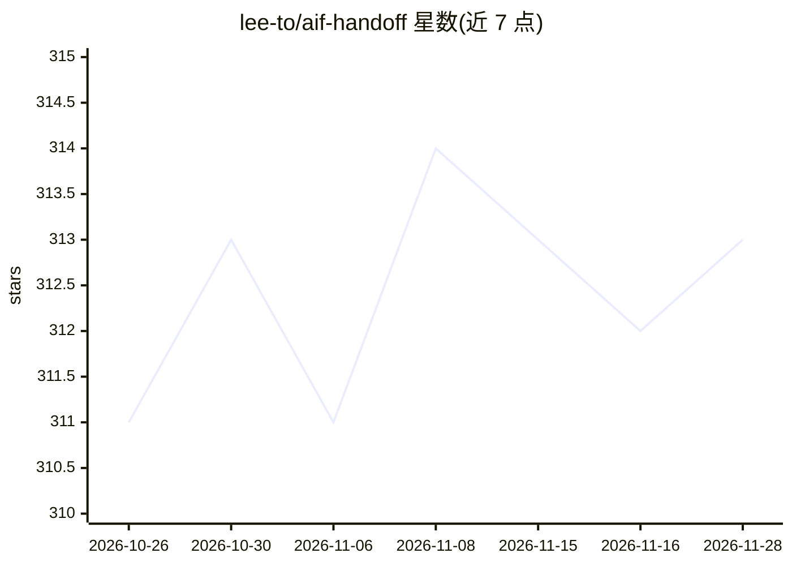

# lee-to/aif-handoff

⭐ 313 · TypeScript · MIT · 推送 2026-11-18 · [GitHub](https://github.com/lee-to/aif-handoff) · [官网](https://aif.cutcode.dev) · 个人维护

**AI 代理自动规划、实现、审查任务的看板工具**

基于看板 UI 的自主任务编排工具：任务在 Backlog→Planning→Plan Ready→Implementing→Review→Done 各阶段由专门的 AI 子代理处理，支持 auto 模式下的审查-返工循环与收敛检测，不收敛时标记为需人工审查。运行时通过 `@aif/runtime` 适配 Claude、Codex、OpenRouter、OpenCode，并可经 `AIF_RUNTIME_MODULES` 加载自定义适配器；提供拖拽看板、WebSocket 实时更新、MCP 双向任务同步与 GitHub Issue-to-PR 模式。需 Node 20.19+/22.12+，`ai-factory` 为必需运行时依赖。

## 筛选速览

| 维度 | 判定 | 备注 |
|---|---|---|
| AI 角色 | `ai-ecosystem` | LLM/agent 周边工具 |
| 许可风险 | `permissive` | MIT |
| 部署形态 | `self-host` | docker 或自建部署 |
| 模型依赖 | locked-api |  |
| 硬件要求 | — | 无带数字的原话,不猜 |
| 安装摩擦 | `low` | 无编译、无系统依赖或容器化 |
| 成熟度 | — | 结构信号不足 |

## 能力要点

- 任务流经六个阶段，由 plan/implement/review 子代理自动编排
- 多运行时可切换：Claude、Codex、OpenRouter、OpenCode，支持自定义适配模块
- 收敛感知的自动审查循环，不收敛时显式移交人工
- MCP 双向任务同步与可选本地账户的 Participants Mode

## 适用场景

- 创建任务后让 AI 代理自动完成规划、实现与审查
- 在不同项目/任务间切换不同的 AI 运行时配置
- 从 GitHub Issue 自动生成实现并产出待人工合并的 PR

## 场景标签

`编码 Agent` `多智能体` · 领域:Agent 开发

## 证据(README 行号)

> L9: Built on top of AI Factory workflow and powered by runtime profiles through `@aif/runtime` (Claude and Codex adapter
> L13: ## Runtime Providers Out of the Box

## 星数曲线

2026-10-26 311 → 2026-11-28 313（+2）

---
*卡片 v1 · prompt 1.4 · 生成 2026-11-25 · 置信度 high · 依据 README sha `8eb6069fb97b` · [字段定义](../../DATASET.md)*
