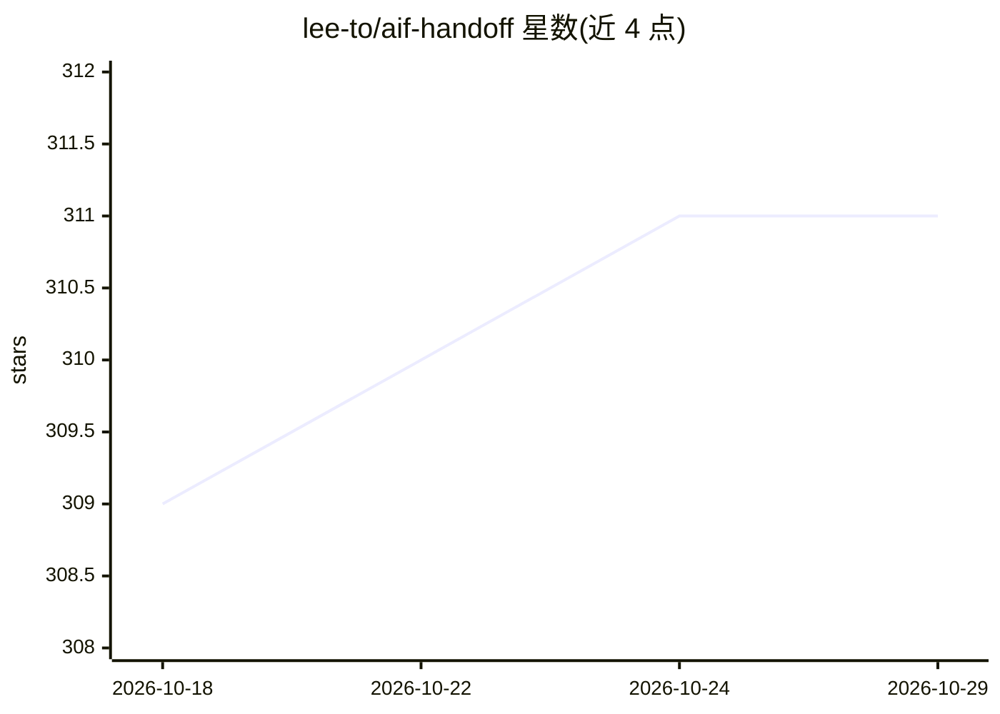

# lee-to/aif-handoff

⭐ 311 · TypeScript · MIT · 推送 2026-10-15 · [GitHub](https://github.com/lee-to/aif-handoff) · [官网](https://aif.cutcode.dev) · 个人维护

**AI 代理自主执行任务的看板：自动规划、实现与评审**

基于 AI Factory 工作流的自治看板应用：任务沿 Backlog → Planning → Implementing → Review → Done 流转，各阶段由专职 AI 子代理编排执行；自动评审具备收敛感知，不收敛时标记需人工复核。运行时内置 Claude（Anthropic）、Codex（OpenAI）、OpenRouter、OpenCode 适配器，可按项目/任务切换，并支持自定义适配器模块。提供拖拽看板 UI、心跳自愈、GitHub Issue-to-PR 模式、MCP 双向同步与可选的 Participants 本地账户协作。无 Docker 时需 Node 20.19+/22.12+ 源码运行，ai-factory 为必需运行时依赖；Docker 部署含 API/Web/Agent 及可选 MCP 四个服务。

## 筛选速览

| 维度 | 判定 | 备注 |
|---|---|---|
| AI 角色 | `ai-native` | 本体是模型或模型工具 |
| 许可风险 | `permissive` | MIT |
| 部署形态 | `self-host` | docker 或自建部署 |
| 模型依赖 | locked-api |  |
| 硬件要求 | — | 无带数字的原话,不猜 |
| 安装摩擦 | `low` | 无编译、无系统依赖或容器化 |
| 成熟度 | — | 结构信号不足 |

## 能力要点

- 任务全流程由 AI 子代理编排（plan/implement coordinator、review + security sidecars）
- 内置 Claude/Codex/OpenRouter/OpenCode 四类运行时适配器，支持自定义模块加载
- 收敛感知的自动评审：不收敛时显式转人工复核而非静默通过
- GitHub Issue-to-PR 模式：每个任务产出一条待人工合并的 PR

## 适用场景

- 把开发任务交给 AI 代理自动规划、实现并评审
- 通过看板 UI 审批计划或完全放手全自动模式
- 从 GitHub Issue 导入并产出可人工合并的 PR

## 场景标签

`编码 Agent` `多智能体` · 领域:Agent 开发

## 证据(README 行号)

> L9: Built on top of AI Factory workflow and powered by runtime profiles through `@aif/runtime` (Claude and Codex adapter
> L28: - **Fully autonomous pipeline** — create a task, AI plans, implements, and reviews it

## 星数曲线

2026-10-18 309 → 2026-10-29 311（+2）

---
*卡片 v1 · prompt 1.4 · 生成 2026-10-21 · 置信度 high · 依据 README sha `5dda48ddead7` · [字段定义](../../DATASET.md)*
