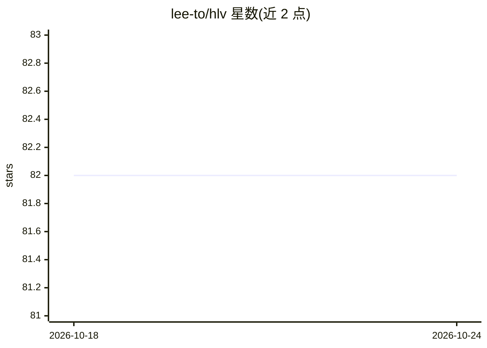

# lee-to/hlv

⭐ 82 · Rust · MIT · 推送 2026-10-07 · [GitHub](https://github.com/lee-to/hlv) · [官网](https://hlv.cutcode.dev) · 个人维护

**校验 LLM 生成代码是否符合规格的 Rust 命令行工具**

编译型 Rust 二进制，面向规格驱动开发（Spec-Driven Development）流程：人类声明 WHAT（规格/约束/里程碑），LLM 生成 HOW（代码），hlv 负责 PROOF——对项目结构、契约、测试规格、REQ→CTR→TST→GATE 追溯链等执行 30+ 项校验。它自身不调用 LLM、不生成代码。提供 hlv check/doctor/milestone 等命令、TUI 仪表盘、内置 MCP 服务器（stdio/HTTP/SSE）供 Claude Code 等 agent 接入，并内置 6 个 agent 技能驱动开发生命周期。支持采用既有 Laravel/Go/Node/Python/Rust 代码库。注意：README 声明项目处于活跃开发期，版本间可能有破坏性变更。

## 筛选速览

| 维度 | 判定 | 备注 |
|---|---|---|
| AI 角色 | `ai-ecosystem` | LLM/agent 周边工具 |
| 许可风险 | `permissive` | MIT |
| 部署形态 | `desktop` | 安装包/桌面程序 |
| 模型依赖 | — | README 未给出锁定关系 |
| 硬件要求 | — | 无带数字的原话,不猜 |
| 安装摩擦 | `low` | 无编译、无系统依赖或容器化 |
| 成熟度 | `idea` | |

## 能力要点

- 30+ 校验覆盖 8 个领域，含追溯链、DAG 计划、质量门禁
- 内置 MCP 服务器（29 个工具、12 个静态资源），供 Claude Code 等 agent 接入
- hlv init --adopt 可挂接既有 Laravel/Go/Node/Python/Rust 代码库
- 内置 6 个 AI agent 技能驱动从访谈到验证的开发周期

## 适用场景

- 我在用 agent 写代码时，希望有独立工具核验输出符合规格再放行
- 为 LLM 生成代码建立需求到代码到测试的追溯链
- 在 CI 中用 hlv check --strict 阻止不达标代码进入下一里程碑

## 场景标签

 · 领域:软件开发工具/LLM 工作流

## 证据(README 行号)

> L14: You define the *what*. LLMs generate the *how*. hlv validates the *proof*.
> L45: hlv is a compiled Rust binary. It doesn't call the LLM. It doesn't generate code. It makes sure LLM output matches 

## 星数曲线

2026-10-18 82 → 2026-10-24 82（+0）

---
*卡片 v1 · prompt 1.4 · 生成 2026-10-24 · 置信度 high · 依据 README sha `4209dbba3d5f` · [字段定义](../../DATASET.md)*
