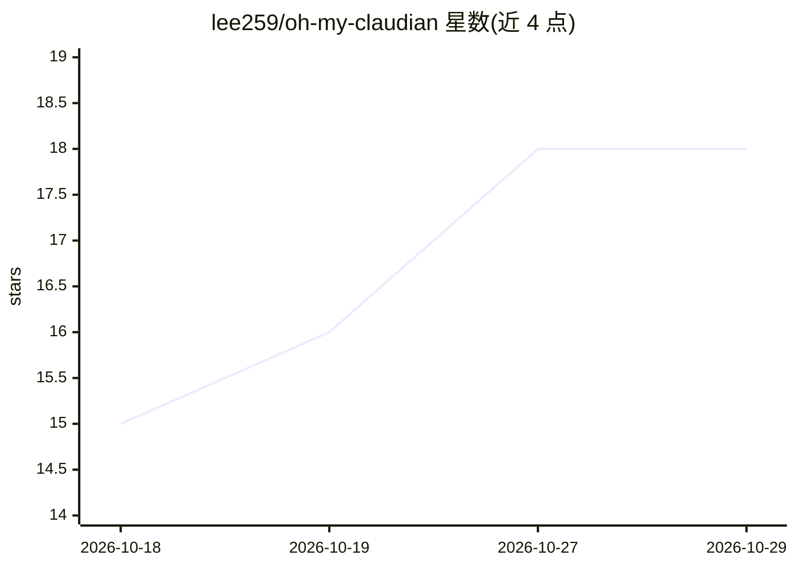

# lee259/oh-my-claudian

⭐ 18 · TypeScript · MIT · 推送 2026-10-28 · [GitHub](https://github.com/lee259/oh-my-claudian) · [官网](https://community.obsidian.md/plugins/oh-my-claudian) · 个人维护 · 中文 README

**在 Obsidian 内接入多种编码 agent 做笔记对话与行内编辑的插件**

Obsidian 社区插件，将 Claude Code、Codex、Cursor Agent、Grok Build、OpenCode、Pi、Oh My Pi、DeepSeek Harness 等 CLI 编码 agent 引入笔记库：侧边栏对话、@ 附加笔记为上下文、选中文字的行内编辑与词级 diff 审阅、文件编辑卡片展开查看变更、保存对话片段为 Markdown 笔记。各 provider 能力不同（模型发现、权限、历史、MCP 等由 provider 决定）；Claude、Codex、DeepSeek Harness、OpenCode、Pi 可执行 Obsidian 原生库操作（反向链接、frontmatter、文件移动）。需桌面版 Obsidian 1.7.2+，认证与计费留在 provider 自身的 CLI，插件本身不含模型订阅。由 Claudian 分叉而来、独立维护，界面支持 10 种语言包括简繁中文。

## 筛选速览

| 维度 | 判定 | 备注 |
|---|---|---|
| AI 角色 | `ai-ecosystem` | LLM/agent 周边工具 |
| 许可风险 | `permissive` | MIT |
| 部署形态 | `library` | 以包/库形式分发 |
| 模型依赖 | locked-api |  |
| 硬件要求 | — | 无带数字的原话,不猜 |
| 安装摩擦 | `low` | 无编译、无系统依赖或容器化 |
| 成熟度 | — | 结构信号不足 |

## 能力要点

- 8 种内置 provider 集成（Claude Code/Codex/Cursor Agent/Grok Build/OMP/OpenCode/Pi/DeepSeek Harness）
- Readiness 检查 provider、CLI、模型目录并提供 CLI 安装/更新动作
- 行内编辑词级 diff 预览与应用、文件编辑卡片 diff 审阅
- Obsidian 原生库操作：反向链接检查、frontmatter 管理、带链接更新的文件移动

## 适用场景

- 在笔记库中让已有编码 agent 汇总散乱笔记并链接出处
- 选中笔记文字请求行内改写并审阅 diff 后应用
- 在阅读笔记时以浮动面板保持对话可用的长会话工作流

## 场景标签

`编码 Agent` `知识库管理` `AI 写作` · 领域:编码与开发

## 证据(README 行号)

> L5: Bring your existing Claude Code, Codex, or another supported coding agent into your vault. Compare source notes, dra
> L80: The built-in provider integrations are:
> L93: Provider capabilities are intentionally different. The plugin exposes controls only when the selected provider supp

## 星数曲线

2026-10-18 15 → 2026-10-29 18（+3）

---
*卡片 v1 · prompt 1.4 · 生成 2026-10-29 · 置信度 high · 依据 README sha `27111d55ee8a` · [字段定义](../../DATASET.md)*
