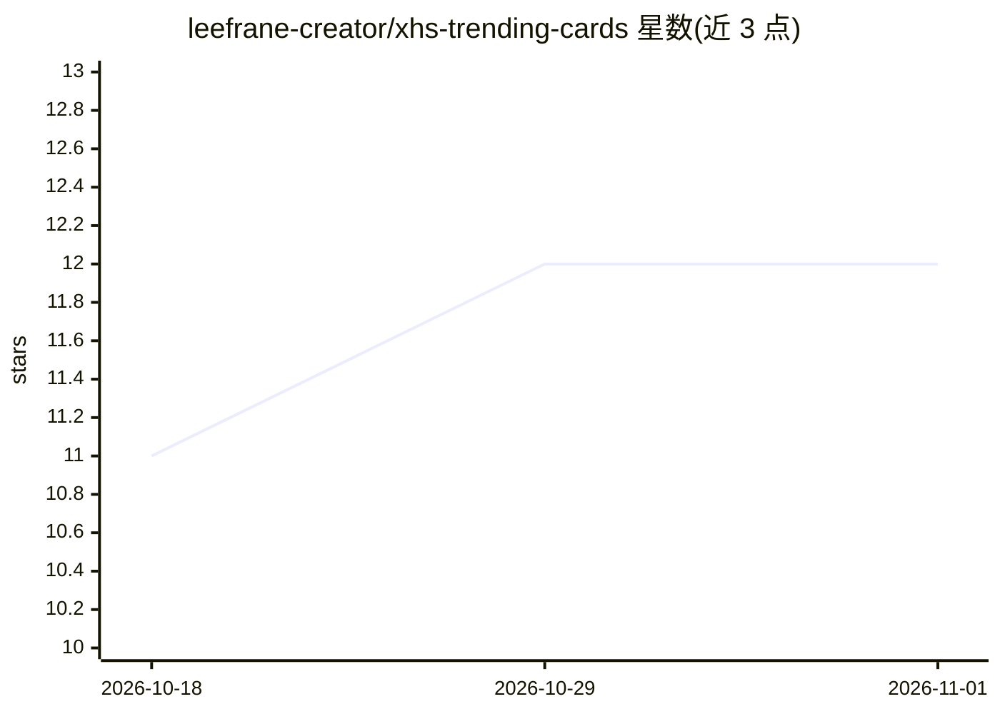

# leefrane-creator/xhs-trending-cards

⭐ 12 · HTML · MIT · 推送 2026-05-30 · [GitHub](https://github.com/leefrane-creator/xhs-trending-cards) · [官网](https://github.com/leefrane-creator/xhs-trending-cards) · 个人维护 · 中文 README

**AI Agent 技能：从小红书榜单数据生成社交传播卡片**

面向 AI Agent 的小红书/社交媒体卡片生成 Skill：读取结构化榜单数据（GitHub Trending、AI 工具、NPM 包、开发者/项目榜等），按 8 种预置样式（A-H，含 Dark Tech、Apple Minimal、macOS Skill Card 等）渲染封面卡与详情卡，支持 HTML 预览与一键 PNG 导出（html2canvas 或 Playwright）。导出后可追加生成配套文案（小红书文案、150 字微头条）。样式元数据以 assets/styles.json 为准，提供 preview_all_styles.js 一键预览全部样式。

## 筛选速览

| 维度 | 判定 | 备注 |
|---|---|---|
| AI 角色 | `ai-ecosystem` | LLM/agent 周边工具 |
| 许可风险 | `permissive` | MIT |
| 部署形态 | `library` | 以包/库形式分发 |
| 模型依赖 | — | README 未给出锁定关系 |
| 硬件要求 | — | 无带数字的原话,不猜 |
| 安装摩擦 | `low` | 无编译、无系统依赖或容器化 |
| 成熟度 | — | 结构信号不足 |

## 能力要点

- 8 种预置卡片样式，覆盖榜单/发布/教程/评分等场景
- 封面卡+详情卡批量渲染，HTML 预览与 PNG 导出
- 配套文案生成（小红书标题+正文+标签、150 字微头条）
- node scripts/preview_all_styles.js 一键生成全部样式预览

## 适用场景

- 把 GitHub Trending / AI 工具榜单做成小红书传播卡片
- 为产品发布或项目盘点生成深色科技风封面与详情卡
- 卡片生成后一并产出平台适配的发布文案

## 场景标签

`AI 写作` · 领域:内容生成

## 证据(README 行号)

> L3: Generate XiaoHongShu / social media ranking cards from structured list data.

## 星数曲线

2026-10-18 11 → 2026-11-01 12（+1）

---
*卡片 v1 · prompt 1.4 · 生成 2026-11-01 · 置信度 mid · 依据 README sha `d2a9d10f2582` · [字段定义](../../DATASET.md)*
