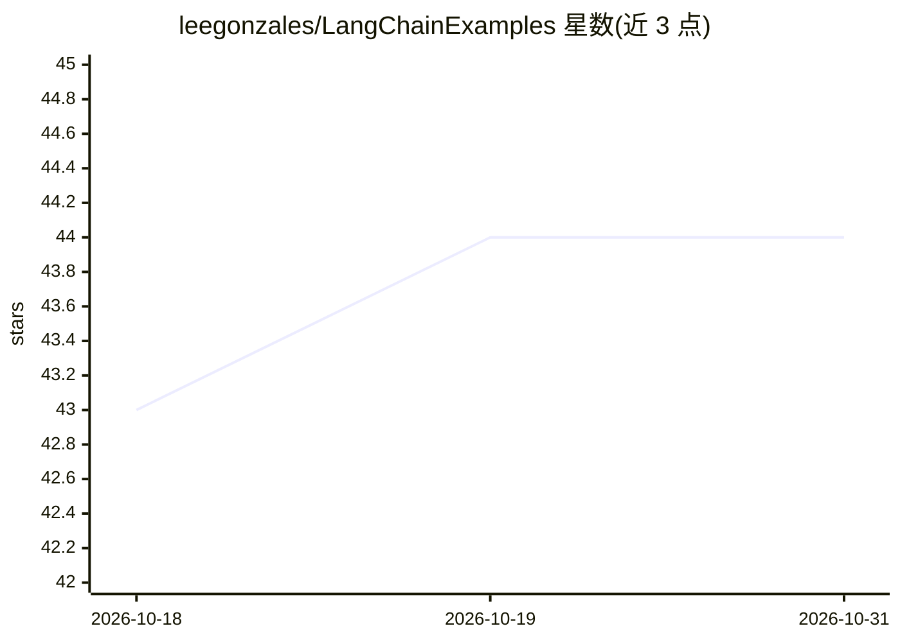

# leegonzales/LangChainExamples

⭐ 44 · Jupyter Notebook · 推送 2026-07-03 · [GitHub](https://github.com/leegonzales/LangChainExamples) · 个人维护

**LangChain 示例集合，主要为 Google Colab 笔记本**

存放 LangChain 使用示例的仓库，内容以 Google Colab 笔记本为主，也可能包含其他形式的示例文件，主题标签为 gpt-3 与 langchain。README 仅一行标题，未提供安装步骤、依赖说明或使用方法描述，具体示例数量、覆盖功能与维护状态无法从可见内容确认。

## 筛选速览

| 维度 | 判定 | 备注 |
|---|---|---|
| AI 角色 | `ai-knowledge` | 知识聚合/清单类 |
| 许可风险 | `none` | — |
| 部署形态 | `None` |  |
| 模型依赖 | — | README 未给出锁定关系 |
| 硬件要求 | — | 无带数字的原话,不猜 |
| 安装摩擦 | `low` | 无编译、无系统依赖或容器化 |
| 成熟度 | — | 结构信号不足 |

## 能力要点

- 以 Google Colab 笔记本形式提供 LangChain 示例
- 主题标签涉及 gpt-3 与 langchain

## 适用场景

- 查找 LangChain 的 notebook 形式参考示例
- 了解 LangChain 与 gpt-3 结合的使用方式

## 场景标签

`教程课程` · 领域:学习与行业

## 证据(README 行号)

> L1: # LangchainExamples

## 星数曲线

2026-10-18 43 → 2026-10-31 44（+1）

---
*卡片 v1 · prompt 1.4 · 生成 2026-10-25 · 置信度 low · 依据 README sha `3614b0612f9a` · [字段定义](../../DATASET.md)*
