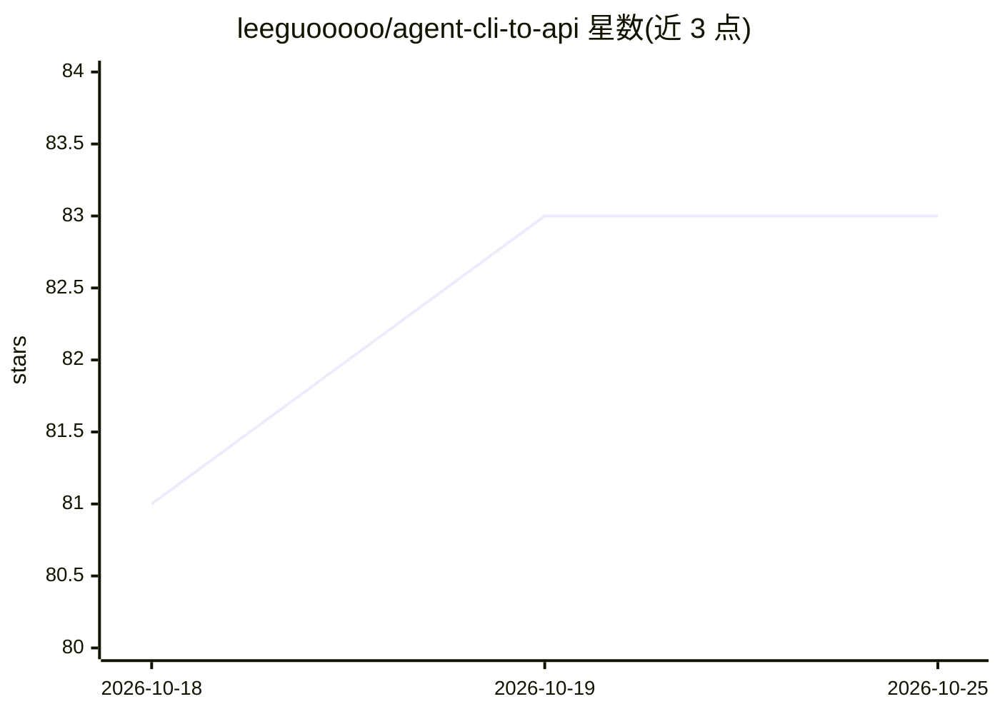

# leeguooooo/agent-cli-to-api

⭐ 83 · Python · 推送 2026-10-07 · [GitHub](https://github.com/leeguooooo/agent-cli-to-api) · 个人维护 · 中文 README

**把 agent CLI（Codex/Claude Code/Cursor/Gemini）封装成 OpenAI 兼容 API 网关**

基于 FastAPI 的本地网关：将 OpenAI Codex、Cursor Agent、Claude Code、Gemini 等 agent CLI 的登录态封装为 OpenAI 兼容的 /v1/chat/completions、/v1/messages 等 HTTP 接口，客户端通过 model 前缀选择后端。Claude 支持读取 ~/.claude/settings.json 自动直连 API（含自定义端点），Codex 后端默认启用 Responses API 与 web search，并可复用 ChatGPT 订阅 OAuth token 提供图像生成（需显式开启，默认关闭）。提供一键安装脚本、uv、pip 三种安装方式，可选 Bearer token 鉴权。限制：各后端仍需本地 CLI 登录，high 质量图像与透明背景在订阅路径不可用。

## 筛选速览

| 维度 | 判定 | 备注 |
|---|---|---|
| AI 角色 | `ai-ecosystem` | LLM/agent 周边工具 |
| 许可风险 | `none` | — |
| 部署形态 | `library` | 以包/库形式分发 |
| 模型依赖 | locked-api |  |
| 硬件要求 | — | 无带数字的原话,不猜 |
| 安装摩擦 | `low` | 无编译、无系统依赖或容器化 |
| 成熟度 | — | 结构信号不足 |

## 能力要点

- 单一网关封装 4 种 agent CLI，按 model 前缀路由后端
- 自动读取 ~/.claude/settings.json 走 Claude 直连 API
- 复用 Codex OAuth token 将 ChatGPT 订阅图像生成暴露为 chat completions 接口（返回 PNG data URI）
- 同时提供 OpenAI 与 Anthropic Messages 两套兼容接口，支持流式

## 适用场景

- 让只支持 OpenAI API 的工具直接调用 Claude Code、Cursor 等本地 agent
- 把 ChatGPT Plus/Pro 订阅的图像生成当作 HTTP API 使用
- 通过 Cloudflare Tunnel 把本地 agent 网关暴露给外部服务

## 场景标签

`模型网关` · 领域:Agent 开发

## 证据(README 行号)

> L3: Expose popular **agent CLIs** as a small **OpenAI-compatible** HTTP API (`/v1/*`).
> L16: - Many tools/SDKs only speak the OpenAI API (`/v1/chat/completions`) - this lets you plug agent CLIs into that ecos

## 星数曲线

2026-10-18 81 → 2026-10-25 83（+2）

---
*卡片 v1 · prompt 1.4 · 生成 2026-10-24 · 置信度 mid · 依据 README sha `0a1c2f8da884` · [字段定义](../../DATASET.md)*
