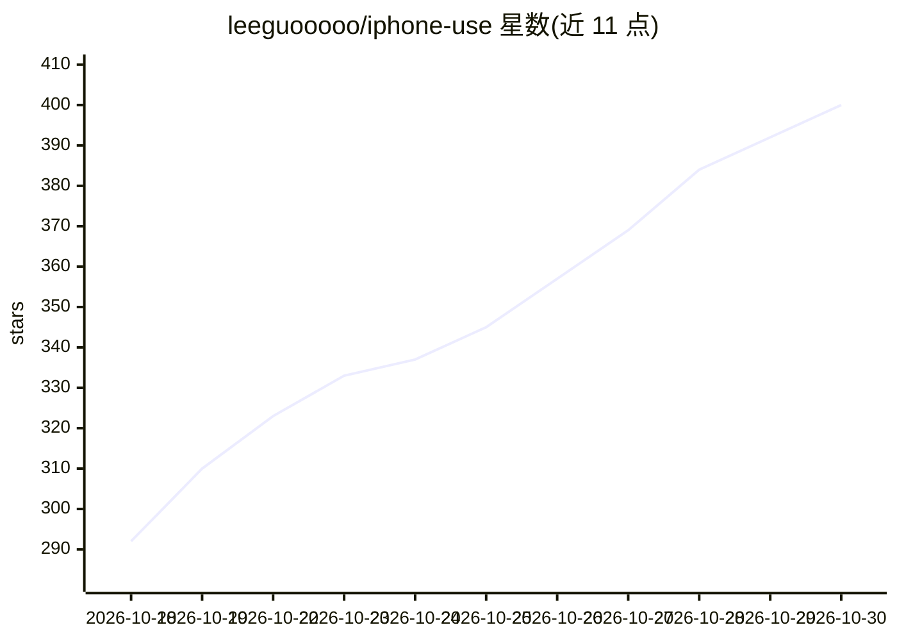

# leeguooooo/iphone-use

⭐ 400 · Rust · NOASSERTION · 推送 2026-10-29 · [GitHub](https://github.com/leeguooooo/iphone-use) · [官网](https://iphone-use.leeguoo.com/en/) · 个人维护 · 中文 README

**让 AI agent 操作真实 iPhone 的 MCP 工具：读屏、点击、输入、滑动**

运行在 macOS 上的自托管守护进程，通过自有 XCTest runner 驱动真实 iPhone（iOS 15+）：以无障碍树文本形式读屏，执行点击、输入（最长 2 万字符）、滑动等操作，适用无 API 的任意 App。以 MCP server 接入 Claude Code、Codex、Cursor 等客户端，另有 HTTP API 与浏览器/iOS App 人工远程控制。支持 USB/Wi-Fi 连接、可回放的 flow（无模型无 Token 重放）、iOS Simulator 开发模式；动作报告应用状态并可拒绝不安全操作。Rust 编写，安装脚本一键部署，需 Xcode 与开发者模式。

## 筛选速览

| 维度 | 判定 | 备注 |
|---|---|---|
| AI 角色 | `ai-ecosystem` | LLM/agent 周边工具 |
| 许可风险 | `none` | NOASSERTION |
| 部署形态 | `None` |  |
| 模型依赖 | locked-api |  |
| 硬件要求 | — | 无带数字的原话,不猜 |
| 安装摩擦 | `low` | 无编译、无系统依赖或容器化 |
| 成熟度 | — | 结构信号不足 |

## 能力要点

- 以无障碍树文本读屏并驱动任意 App，无需目标 App 提供 API
- MCP server / HTTP API / 网页与 iOS App 三种控制形式
- 任务可保存为 flow，无模型零 Token 重放
- 安全限制：登录环节交还用户、可屏蔽指定 App、限制单任务动作数、无遥测

## 适用场景

- 让 Claude Code 或 Codex 在真机上完成无 API App 的操作任务
- 在真实 iPhone 上运行 App 登录测试并定位失败步骤
- 通过浏览器远程操控自己的 iPhone 处理银行、聊天等应用

## 场景标签

`GUI 自动化` · 领域:效率与自动化

## 证据(README 行号)

> L72:  Claude Code / Codex / any MCP client ──MCP──┐
> L75:                           iphone-use daemon on your Mac ──USB or Wi-Fi──▶ XCTest runner on the iPhone
> L141: - an **MCP server** for Claude Code, Codex, Claude Desktop, Cursor and other MCP clients;

## 星数曲线

2026-10-18 292 → 2026-10-30 400（+108）

---
*卡片 v1 · prompt 1.4 · 生成 2026-10-21 · 置信度 high · 依据 README sha `6c75bf01816f` · [字段定义](../../DATASET.md)*
