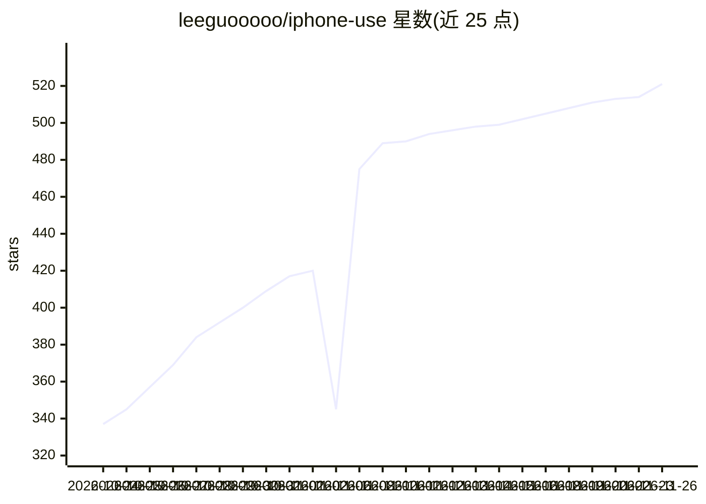

# leeguooooo/iphone-use

⭐ 521 · Rust · NOASSERTION · 推送 2026-11-25 · [GitHub](https://github.com/leeguooooo/iphone-use) · [官网](https://iphone-use.leeguoo.com/en/) · 个人维护 · 中文 README

**让 AI agent 通过 MCP 操作真实 iPhone 的 macOS 守护进程**

在 Mac 上运行的守护进程，通过自装的 XCTest runner 读取 iPhone 屏幕的无障碍树（文本而非像素），并发送点击、输入、滑动指令；同时向 MCP 客户端提供 MCP server、向脚本提供 HTTP API、向人提供网页与 iOS 远程控制。支持 USB/Wi-Fi 连接、可回放的 flow、防截屏应用的线框视图；安全机制包括登录时交还人工、屏蔽应用清单与动作次数上限。需 macOS 15+ 与 iOS 15+ 设备。

## 筛选速览

| 维度 | 判定 | 备注 |
|---|---|---|
| AI 角色 | `ai-ecosystem` | LLM/agent 周边工具 |
| 许可风险 | `none` | NOASSERTION |
| 部署形态 | `None` |  |
| 模型依赖 | — | README 未给出锁定关系 |
| 硬件要求 | — | 无带数字的原话,不猜 |
| 安装摩擦 | `low` | 无编译、无系统依赖或容器化 |
| 成熟度 | — | 结构信号不足 |

## 能力要点

- 自有 XCTest runner，读屏约 0.1s，点击返回稳定屏幕约 1.9s
- 一次任务可存为 flow，回放无需模型与 token
- 同时提供 MCP server、HTTP API 与网页/iOS 远程控制三种接入形式
- 安装器自动向 Claude Code/Codex/Cursor/Claude Desktop 注册 MCP server

## 适用场景

- 让 Claude Code 或 Codex 代我操作手机上的任意 App
- 在真实 iPhone 上运行自己 App 的登录测试流程
- 通过浏览器或另一台 iPhone 远程控制手机
- 批量读取银行账单、聊天记录等页面内容

## 场景标签

`GUI 自动化` · 领域:效率与自动化

## 证据(README 行号)

> L5:  Let AI agents use your real iPhone.
> L88: One daemon per phone runs on the Mac. It reads the screen as an accessibility tree (text, not pixels), sends taps a
> L154: - an **MCP server** for Claude Code, Codex, Claude Desktop, Cursor and other MCP clients;

## 星数曲线

2026-10-24 337 → 2026-11-26 521（+184）

---
*卡片 v1 · prompt 1.4 · 生成 2026-11-26 · 置信度 high · 依据 README sha `a75e8ca5ebc7` · [字段定义](../../DATASET.md)*
