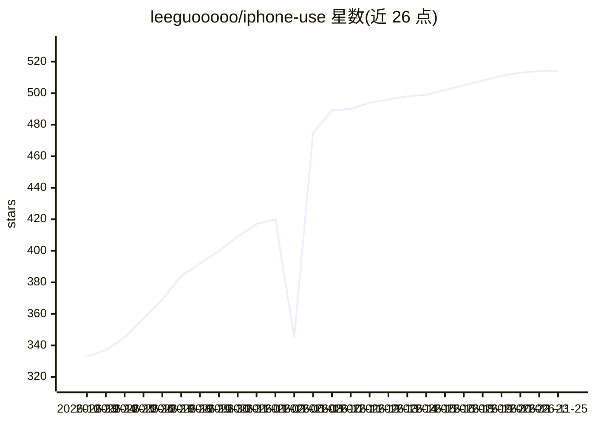

# leeguooooo/iphone-use

⭐ 514 · Rust · NOASSERTION · 推送 2026-11-21 · [GitHub](https://github.com/leeguooooo/iphone-use) · [官网](https://iphone-use.leeguoo.com/en/) · 个人维护 · 中文 README

**让 AI agent 通过 MCP 操作真实 iPhone 的 macOS 工具**

运行于 macOS 的守护进程，通过自有 XCTest runner 以无障碍树文本形式读取 iPhone 屏幕，并执行点击、输入、滑动等操作，支持 USB 或 Wi-Fi 连接，iOS 15 及以上设备无需越狱。对外提供 MCP server、HTTP API 与网页/iOS 远程控制三种接口，一次任务可录制成可回放 flow（无模型、无 token 消耗）。安装需 Mac（macOS 15+、登录 Apple ID 的 Xcode）与开启开发者模式的 iPhone；许可为 PolyForm Shield 1.0.0，另有付费配置与赞助服务。

## 筛选速览

| 维度 | 判定 | 备注 |
|---|---|---|
| AI 角色 | `ai-ecosystem` | LLM/agent 周边工具 |
| 许可风险 | `none` | NOASSERTION |
| 部署形态 | `None` |  |
| 模型依赖 | — | README 未给出锁定关系 |
| 硬件要求 | — | 无带数字的原话,不猜 |
| 安装摩擦 | `low` | 无编译、无系统依赖或容器化 |
| 成熟度 | — | 结构信号不足 |

## 能力要点

- 自有 XCTest runner，读屏约 0.1 s，以文本（无障碍树）而非像素读取屏幕
- 任务可录制成可回放 flow，重放时无需模型与 token
- 支持 USB/Wi-Fi、远程控制（浏览器/iOS 应用、H.264 串流、QR 配对）、Tailscale/Cloudflare 隧道
- 安全机制：密码/Face ID 交由用户完成、应用黑名单、单任务动作上限

## 适用场景

- 让 Claude Code/Codex 等 agent 代我操作健康、微信、银行等无 API 的应用
- iOS 应用开发者/测试员在真机上跑登录测试、读日志与崩溃报告、安装 ipa
- 远程通过浏览器或另一台 iPhone 操控家里的手机
- 开发期用 iOS Simulator 代替真机调试 agent 流程

## 场景标签

`GUI 自动化` · 领域:效率与自动化

## 证据(README 行号)

> L15:  MCP server
> L154: - an **MCP server** for Claude Code, Codex, Claude Desktop, Cursor and other MCP clients;
> L155: - an **HTTP API** for agents and scripts (`/agent/*`);

## 星数曲线

2026-10-23 333 → 2026-11-25 514（+181）

---
*卡片 v1 · prompt 1.4 · 生成 2026-11-25 · 置信度 high · 依据 README sha `f6289be00780` · [字段定义](../../DATASET.md)*
