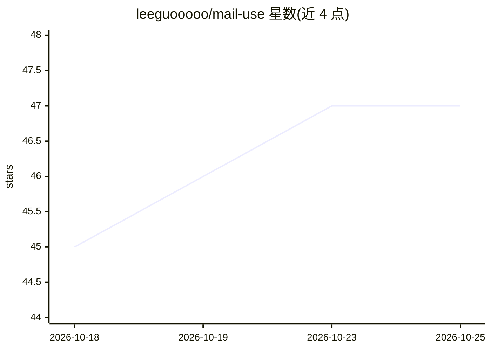

# leeguooooo/mail-use

⭐ 47 · JavaScript · MIT · 推送 2026-10-13 · [GitHub](https://github.com/leeguooooo/mail-use) · 个人维护 · 中文 README

**让 AI agent 操作邮箱的 CLI/MCP 工具：收发搜索管理邮件**

面向 AI agent 的邮件命令行工具，统一封装 Gmail、QQ、163、Outlook 及任意 IMAP/SMTP 账户：每条命令输出带 success/error_code 的稳定 JSON，读取带缓存元数据（from_cache/cache_stale），delete/mark/move/send 等破坏性操作默认 dry-run 预览，需 --confirm 才执行。提供 compact 输出与持久 daemon（连接池 + SQLite 后台同步）加速循环调用，另有暴露 16 个工具的 MCP server、Claude Code/Cursor 技能安装与 OpenClaw 集成。邮件分类决策留给调用方 AI。macOS/Linux 提供预编译二进制，curl 一键安装，Windows 未提及。

## 筛选速览

| 维度 | 判定 | 备注 |
|---|---|---|
| AI 角色 | `ai-ecosystem` | LLM/agent 周边工具 |
| 许可风险 | `permissive` | MIT |
| 部署形态 | `library` | 以包/库形式分发 |
| 模型依赖 | — | README 未给出锁定关系 |
| 硬件要求 | — | 无带数字的原话,不猜 |
| 安装摩擦 | `low` | 无编译、无系统依赖或容器化 |
| 成熟度 | — | 结构信号不足 |

## 能力要点

- 统一 JSON 契约，破坏性操作默认 dry-run 需 --confirm
- 持久 daemon 池化 IMAP 连接并后台同步 SQLite（5 次 list 从 25s 到 0.83s）
- MCP server 暴露 16 个工具，支持 Claude Code/Cursor 技能与 OpenClaw 集成
- 缓存读取携带 from_cache/cache_age/cache_stale 元数据，过期快照拒绝使用

## 适用场景

- 让 AI agent 读取最新验证码或搜索邮件并输出结构化 JSON
- 通过 MCP 让 Claude/Cursor 等 agent 收发、整理邮箱
- 在 token 预算内批量扫描和清理邮件（compact 格式 + 分页）

## 场景标签

 · 领域:AI agent 工具/邮件

## 证据(README 行号)

> L3: **Email, as something an AI agent can actually operate.** One CLI over Gmail, QQ,
> L13: Part of the `*-use` family — small tools that each give an agent
> L35: - **MCP too.** `mail-use mcp config --json` prints a paste-ready entry; the server

## 星数曲线

2026-10-18 45 → 2026-10-25 47（+2）

---
*卡片 v1 · prompt 1.4 · 生成 2026-10-25 · 置信度 mid · 依据 README sha `73ecb7a23e39` · [字段定义](../../DATASET.md)*
