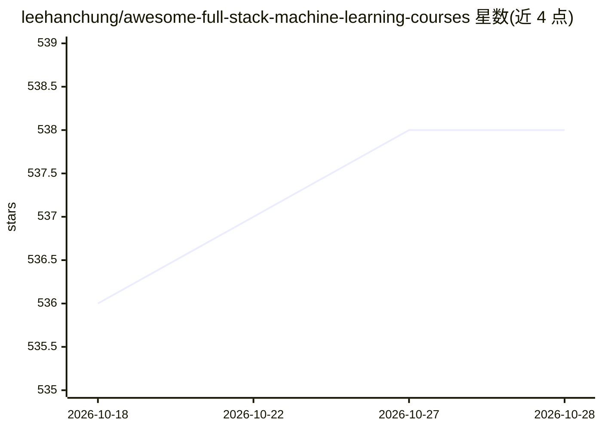

# leehanchung/awesome-full-stack-machine-learning-courses

⭐ 538 · JavaScript · CC0-1.0 · 推送 2026-06-22 · [GitHub](https://github.com/leehanchung/awesome-full-stack-machine-learning-courses) · 个人维护

**机器学习工程公开课程策展清单：覆盖基础到生产部署**

策展公开可访问的机器学习课程与教材清单，收录 Berkeley、Stanford、MIT、Harvard、Columbia、CalTech 等高校课程及 Google、Facebook 等公司实践资料。按计算机科学、数学统计、人工智能、机器学习、机器学习工程、深度学习及推荐系统、信息检索等专题组织；含 LLM/Agents 最短学习路径与 TL;DR 最小课程集合。条目用星级与视频图标标注推荐程度和讲义链接，部分附参考答案。

## 筛选速览

| 维度 | 判定 | 备注 |
|---|---|---|
| AI 角色 | `ai-knowledge` | 知识聚合/清单类 |
| 许可风险 | `viral` | CC0-1.0 |
| 部署形态 | `None` |  |
| 模型依赖 | — | README 未给出锁定关系 |
| 硬件要求 | — | 无带数字的原话,不猜 |
| 安装摩擦 | `low` | 无编译、无系统依赖或容器化 |
| 成熟度 | — | 结构信号不足 |

## 能力要点

- 按主题与专业方向分类的课程与教材清单
- 提供 LLM/Agents 与机器学习工程两条最短学习路径
- 标注推荐课程（:star:）与视频讲义（:tv:）
- 覆盖从数学基础到生产部署的端到端机器学习工程内容

## 适用场景

- 系统规划从基础到生产的机器学习工程学习路径
- 按专题查找高校公开课程与教材
- 快速获取 LLM 与 AI Agents 的入门课程组合

## 场景标签

`精选清单` · 领域:学习与行业

## 证据(README 行号)

> L7: This is a curated list of publicly accessible machine learning courses from top universities such as Berkeley, Harva
> L18: ## Table of Contents

## 星数曲线

2026-10-18 536 → 2026-10-28 538（+2）

---
*卡片 v1 · prompt 1.4 · 生成 2026-10-21 · 置信度 high · 依据 README sha `9c8d90e642fc` · [字段定义](../../DATASET.md)*
