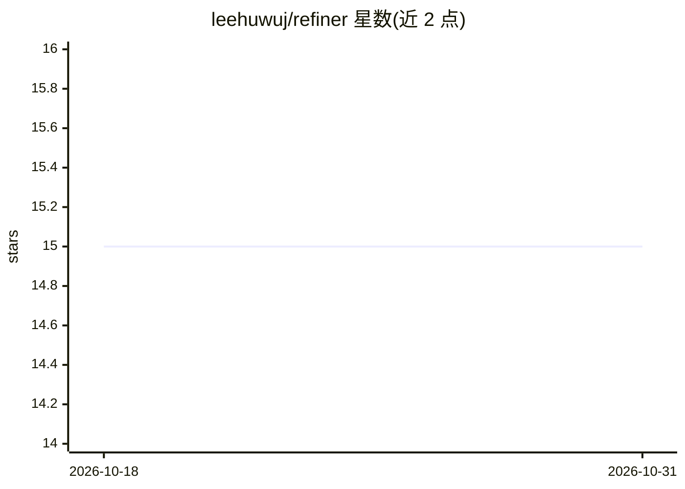

# leehuwuj/refiner

⭐ 15 · TypeScript · MIT · 推送 2026-09-01 · [GitHub](https://github.com/leehuwuj/refiner) · 个人维护

**用 LLM 翻译或润色文本的桌面应用（macOS/Windows）**

基于 Tauri 的 AI 文本处理桌面应用：读取输入文本，调用 LLM 进行翻译（目标语言）或按自定义提示词润色，支持通过快捷键 Cmd+E 快速翻译选中文本。提供商支持 OpenAI、Ollama（本地离线模式）、Gemini、Groq，使用 OpenAI 需配置 API key。macOS 从 Release 页下载 .dmg 安装，快捷键功能需授予辅助功能权限；Linux 尚未支持。

## 筛选速览

| 维度 | 判定 | 备注 |
|---|---|---|
| AI 角色 | `ai-native` | 本体是模型或模型工具 |
| 许可风险 | `permissive` | MIT |
| 部署形态 | `desktop` | 安装包/桌面程序 |
| 模型依赖 | local-ok | 支持本地模型 |
| 硬件要求 | — | 无带数字的原话,不猜 |
| 安装摩擦 | `low` | 无编译、无系统依赖或容器化 |
| 成熟度 | — | 结构信号不足 |

## 能力要点

- 文本翻译与自定义提示词润色
- 支持 OpenAI、Ollama、Gemini、Groq 四种提供商，Ollama 可本地离线运行
- Cmd+E 快捷键快速翻译选中文本

## 适用场景

- 日常阅读或写作时快速翻译选中的文本
- 用本地 Ollama 离线翻译，不外发数据
- 用自定义提示词按不同风格润色文本

## 场景标签

`AI 写作` · 领域:内容生成

## 证据(README 行号)

> L5:  Refiner : A simple AI-powered application for translating or refining text.
> L8:  - [x] Translation: Translate inputted text to a target language.

## 星数曲线

2026-10-18 15 → 2026-10-31 15（+0）

---
*卡片 v1 · prompt 1.4 · 生成 2026-10-30 · 置信度 high · 依据 README sha `ccc032c337fc` · [字段定义](../../DATASET.md)*
