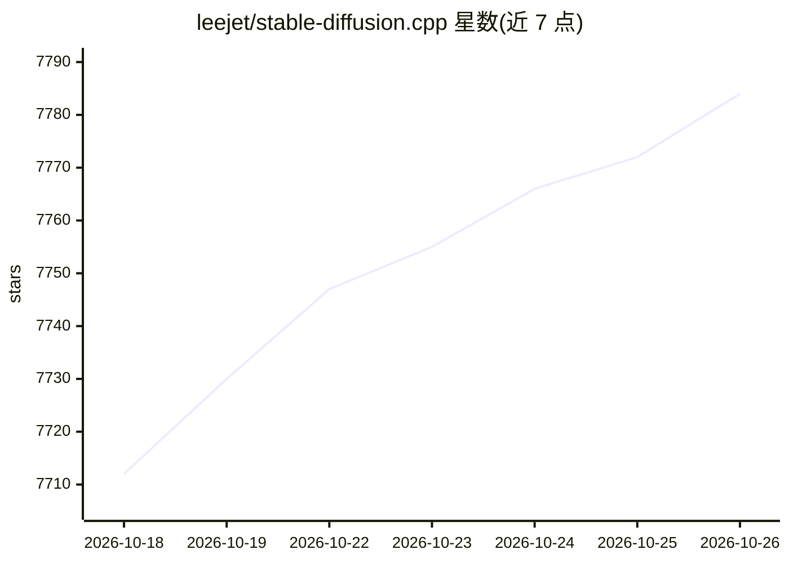

# leejet/stable-diffusion.cpp

⭐ 7,784 · C++ · MIT · 推送 2026-10-25 · [GitHub](https://github.com/leejet/stable-diffusion.cpp) · 个人维护

**纯 C/C++ 的扩散模型推理引擎，本地生成图片与视频**

基于 ggml 的纯 C/C++ 扩散模型推理实现，工作方式与 llama.cpp 相同，无外部依赖。支持 SD1.x/SDXL/SD3.5/FLUX/Qwen-Image/Z-Image 等数十种图像模型、图像编辑模型与 Wan2.x/LTX 等 Video 模型，提供 txt2img/img2img、LoRA、ControlNet、IP-Adapter、多种采样器与量化 GGUF 权重。后端覆盖 CPU(AVX/AVX2/AVX512)/CUDA/Vulkan/Metal/OpenCL/SYCL，平台含 Linux/macOS/Windows/Android(Termux)。提供 CLI 与嵌入式 web UI，可从 releases 下载预编译二进制或自行编译。README 声明项目处于活跃开发期，API 与命令行选项可能频繁变更。

## 筛选速览

| 维度 | 判定 | 备注 |
|---|---|---|
| AI 角色 | `ai-native` | 本体是模型或模型工具 |
| 许可风险 | `permissive` | MIT |
| 部署形态 | `desktop` | 安装包/桌面程序 |
| 模型依赖 | — | README 未给出锁定关系 |
| 硬件要求 | — | 无带数字的原话,不猜 |
| 安装摩擦 | `medium` | 含编译或系统依赖之一 |
| 成熟度 | `idea` | |

## 能力要点

- 基于 ggml 的纯 C/C++ 实现，无外部依赖
- 支持数十种图像/图像编辑/视频扩散模型及 LoRA、ControlNet、IP-Adapter
- 六种计算后端（CPU/CUDA/Vulkan/Metal/OpenCL/SYCL）
- 权重格式支持 ckpt/safetensors/GGUF，并可转换模型格式

## 适用场景

- 在本地 CPU 或 GPU 上运行 Stable Diffusion/FLUX 等模型生成图片
- 将扩散模型权重转换为 GGUF 量化格式
- 在 Android(Termux) 等轻量环境本地跑图
- 作为后端接入 GUI 或其他语言绑定做图像生成

## 场景标签

`图像生成` `视频生成` `推理引擎` `模型量化` · 领域:内容生成

## 证据(README 行号)

> L5: Diffusion model(SD,Flux,Wan,...) inference in pure C/C++
> L33: - Plain C/C++ implementation based on ggml, working in the same way as llama.cpp

## 星数曲线

2026-10-18 7,712 → 2026-10-26 7,784（+72）

---
*卡片 v1 · prompt 1.4 · 生成 2026-10-20 · 置信度 high · 依据 README sha `f945e3aa53d4` · [字段定义](../../DATASET.md)*
