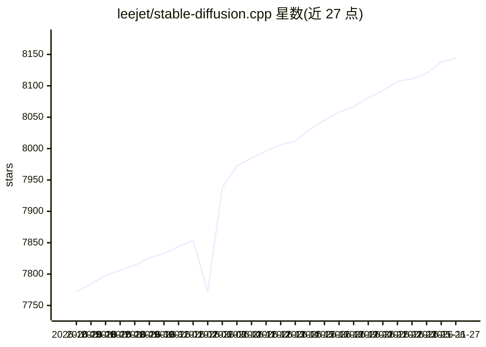

# leejet/stable-diffusion.cpp

⭐ 8,144 · C++ · MIT · 推送 2026-11-26 · [GitHub](https://github.com/leejet/stable-diffusion.cpp) · 个人维护 · 中文 README

**用纯 C/C++ 本地推理扩散模型生成图像与视频**

基于 ggml 的纯 C/C++ 实现的扩散模型推理引擎，以 llama.cpp 同样的方式本地运行，无外部依赖。支持 SD/SDXL/SD3.5、FLUX、Qwen Image、Wan 等数十种图像、图像编辑与视频模型，提供内置 Web UI（sd-server）与命令行（sd-cli）两种使用入口，支持 LoRA、ControlNet、IP-Adapter、ESRGAN 放大与多种采样器。权重支持 ckpt/safetensors/GGUF 格式并可互转。跨平台预编译二进制可直接下载，也可源码构建；项目声明处于活跃开发期，API 与命令行选项可能频繁变动。

## 筛选速览

| 维度 | 判定 | 备注 |
|---|---|---|
| AI 角色 | `ai-native` | 本体是模型或模型工具 |
| 许可风险 | `permissive` | MIT |
| 部署形态 | `desktop` | 安装包/桌面程序 |
| 模型依赖 | — | README 未给出锁定关系 |
| 硬件要求 | — | 无带数字的原话,不猜 |
| 安装摩擦 | `medium` | 含编译或系统依赖之一 |
| 成熟度 | `idea` | |

## 能力要点

- 纯 C/C++ 基于 ggml 实现，无外部依赖
- 支持数十种图像/图像编辑/视频模型（SD、FLUX、Qwen Image、Wan 等）
- CPU（AVX/AVX2/AVX512）、CUDA、Vulkan、Metal、OpenCL、SYCL 多后端
- 内置 Web UI 与 CLI 两种入口，支持 GGUF/safetensors/ckpt 权重

## 适用场景

- 在本地 CPU 或 GPU 上离线生成图像与视频
- 在无 Python 环境或边缘设备（含 Android Termux）上运行扩散模型
- 通过 GGUF 量化权重降低显存/内存占用
- 用 CLI 脚本批量生成图像

## 场景标签

`图像生成` `视频生成` `推理引擎` `模型量化` · 领域:内容生成

## 证据(README 行号)

> L5: Diffusion model(SD,Flux,Wan,...) inference in pure C/C++
> L34: - Plain C/C++ implementation based on ggml, working in the same way as llama.cpp
> L36: - Built-in Web UI for image and video generation

## 星数曲线

2026-10-25 7,772 → 2026-11-27 8,144（+372）

---
*卡片 v1 · prompt 1.4 · 生成 2026-11-24 · 置信度 high · 依据 README sha `fd64a2e47471` · [字段定义](../../DATASET.md)*
