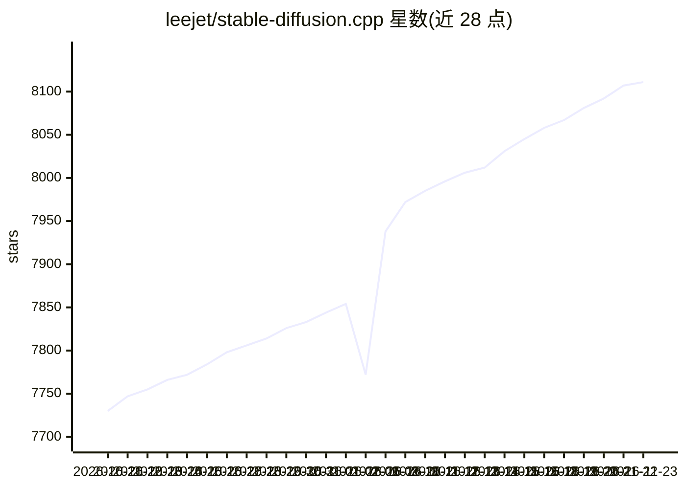

# leejet/stable-diffusion.cpp

⭐ 8,111 · C++ · MIT · 推送 2026-11-22 · [GitHub](https://github.com/leejet/stable-diffusion.cpp) · 个人维护

**纯 C/C++ 的扩散模型推理引擎，本地生成图像与视频**

基于 ggml 的纯 C/C++ 实现扩散模型推理，与 llama.cpp 同一技术路线，无外部依赖。支持 SD/FLUX/Qwen Image/Wan 等大量图像、图像编辑、视频及视频超分模型，提供 Web UI（内置 sd-server）与 CLI（sd-cli）两种使用方式；后端覆盖 CPU/CUDA/Vulkan/Metal/OpenCL/SYCL，读取 ckpt/safetensors/GGUF 权重并支持格式转换，另有 LoRA、ControlNet、PhotoMaker、IP-Adapter、负向提示词与多种采样器。项目处于活跃开发期，API 与命令行选项可能频繁变更。

## 筛选速览

| 维度 | 判定 | 备注 |
|---|---|---|
| AI 角色 | `ai-native` | 本体是模型或模型工具 |
| 许可风险 | `permissive` | MIT |
| 部署形态 | `desktop` | 安装包/桌面程序 |
| 模型依赖 | — | README 未给出锁定关系 |
| 硬件要求 | — | 无带数字的原话,不猜 |
| 安装摩擦 | `medium` | 含编译或系统依赖之一 |
| 成熟度 | `idea` | |

## 能力要点

- 纯 C/C++ 基于 ggml，无外部依赖，支持 Linux/macOS/Windows/Android(Termux)
- 支持图像、图像编辑、视频与视频超分多类模型及 LoRA/ControlNet/IP-Adapter
- 后端覆盖 CPU(AVX2/AVX512)/CUDA/Vulkan/Metal/OpenCL/SYCL
- 内置 Web UI 与 CLI，读取并转换 ckpt/safetensors/GGUF 权重

## 适用场景

- 在没有 Python 环境的机器上本地运行图像/视频生成模型
- CPU 或 Vulkan 等非 CUDA 环境下推理扩散模型
- 将模型权重转换为 GGUF 以降低内存占用
- 通过内置 Web UI 快速生成图片和视频

## 场景标签

`图像生成` `视频生成` `推理引擎` `模型量化` · 领域:内容生成

## 证据(README 行号)

> L5: Diffusion model(SD,Flux,Wan,...) inference in pure C/C++
> L34: - Plain C/C++ implementation based on ggml, working in the same way as llama.cpp
> L36: - Built-in Web UI for image and video generation

## 星数曲线

2026-10-21 7,730 → 2026-11-23 8,111（+381）

---
*卡片 v1 · prompt 1.4 · 生成 2026-11-22 · 置信度 high · 依据 README sha `b0fb576ea6ff` · [字段定义](../../DATASET.md)*
