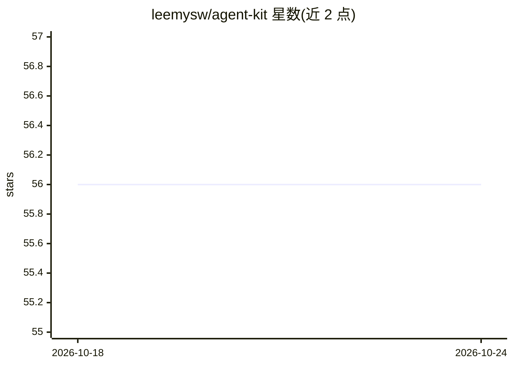

# leemysw/agent-kit

⭐ 56 · Python · Apache-2.0 · 推送 2026-03-14 · [GitHub](https://github.com/leemysw/agent-kit) · 个人维护 · 中文 README

**基于 Claude Agent SDK 的全栈 AI 智能体开发框架**

整合 Claude Agent SDK 的前后端一体智能体开发框架：FastAPI 异步后端 + Next.js 前端，通过 WebSocket、Discord、Telegram 三种消息通道统一接入，跨渠道共享会话路由；支持流式响应、多 Agent 管理（每 Agent 独立工作区与配置）、细粒度工具权限控制。存储基于工作区文件（meta.json / messages.jsonl），首次启动自动迁移旧 SQLite 数据。提供 Docker 与本地开发两种部署方式；自定义工具、Skills、MCP 支持标注为开发中。

## 筛选速览

| 维度 | 判定 | 备注 |
|---|---|---|
| AI 角色 | `ai-ecosystem` | LLM/agent 周边工具 |
| 许可风险 | `permissive` | Apache-2.0 |
| 部署形态 | `self-host` | docker 或自建部署 |
| 模型依赖 | locked-api |  |
| 硬件要求 | — | 无带数字的原话,不猜 |
| 安装摩擦 | `low` | 无编译、无系统依赖或容器化 |
| 成熟度 | `idea` | |

## 能力要点

- 深度集成 Claude Agent SDK，支持流式响应
- WebSocket / Discord / Telegram 三通道统一会话路由
- 多 Agent 管理：独立工作区、Agent 级模型/权限/工具配置
- 细粒度工具权限控制与用户确认机制

## 适用场景

- 快速搭建并部署生产级 AI Agent 应用
- 让同一个 Agent 同时接入 Web、Discord、Telegram
- 管理多个 Agent 及其各自的会话与工作区

## 场景标签

`Agent 框架` · 领域:Agent 开发

## 证据(README 行号)

> L16: **Agent Kit** is a comprehensive AI agent development framework that integrates **Claude Agent SDK**, providing a c
> L33: - Deep Claude Agent SDK integration
> L63: - **Agent API Key**: Get from Anthropic or Bigmodel

## 星数曲线

2026-10-18 56 → 2026-10-24 56（+0）

---
*卡片 v1 · prompt 1.4 · 生成 2026-10-24 · 置信度 high · 依据 README sha `ce87fb53c89b` · [字段定义](../../DATASET.md)*
