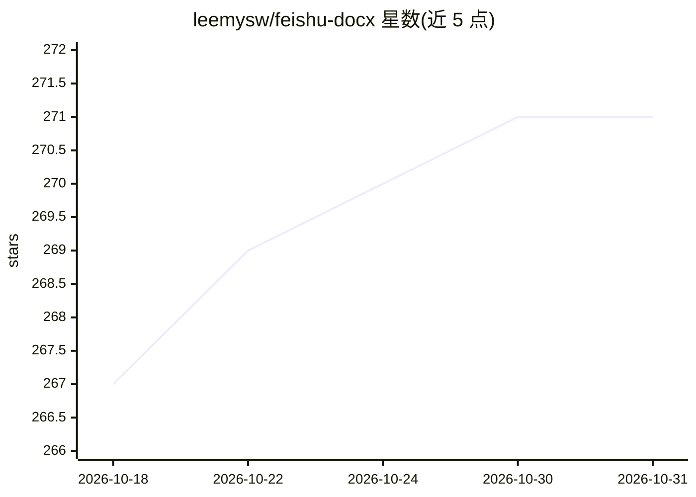

# leemysw/feishu-docx

⭐ 271 · Python · MIT · 推送 2026-09-23 · [GitHub](https://github.com/leemysw/feishu-docx) · 个人维护 · 中文 README

**飞书文档读写与云空间管理 CLI/TUI，供 AI Agent 接入知识库**

面向飞书/Lark 的知识库导出、写入与云空间管理工具：将 Docx、Sheet、Bitable、Wiki 节点及微信公众号文章转换为 Markdown（可选 PDF 与浏览器导出），支持创建文档、追加内容、更新指定块，以及列文件、删文件、管理权限等 Drive 操作。提供 CLI 与 Textual TUI 双界面，默认 tenant_access_token 自动获取，也可走 OAuth 2.0 用户级授权。内置 Claude Skill（SKILL.md），可被 OpenCode、Claude Code、Codex、Cursor 等 Agent 框架直接调用读写飞书知识库。限制：需在飞书开放平台自建应用并配置权限；浏览器导出需额外安装 Playwright/Chromium。

## 筛选速览

| 维度 | 判定 | 备注 |
|---|---|---|
| AI 角色 | `ai-ecosystem` | LLM/agent 周边工具 |
| 许可风险 | `permissive` | MIT |
| 部署形态 | `library` | 以包/库形式分发 |
| 模型依赖 | — | README 未给出锁定关系 |
| 硬件要求 | — | 无带数字的原话,不猜 |
| 安装摩擦 | `low` | 无编译、无系统依赖或容器化 |
| 成熟度 | — | 结构信号不足 |

## 能力要点

- 文档/表格/多维表格/Wiki 批量导出为 Markdown，支持层级递归
- 写回能力：创建文档、追加 Markdown、更新指定块
- 内置 Claude Skill，支持 OpenCode/Claude Code/Codex/Cursor
- Tenant 与 OAuth 2.0 双认证模式，token 自动刷新
- Drive 云空间管理：列文件、删除、权限增删改查

## 适用场景

- 把飞书知识库批量导出成 Markdown 做备份或迁移
- 让 Claude 等 Agent 读取和写入我的飞书文档
- 通过 CLI 管理应用云空间里的文件和权限
- 把微信公众号文章转成 Markdown 或直接存为飞书文档

## 场景标签

`文档解析` `知识库管理` · 领域:知识与检索

## 证据(README 行号)

> L25: **Let AI Agents read, write, and manage your Feishu/Lark knowledge base.**
> L27: - 🤖 **Built for AI** — Works seamlessly with Claude/GPT Skills for document retrieval
> L95: This project includes a Claude Skill at `.skills/feishu-docx/SKILL.md`.

## 星数曲线

2026-10-18 267 → 2026-10-31 271（+4）

---
*卡片 v1 · prompt 1.4 · 生成 2026-10-22 · 置信度 high · 依据 README sha `02e844d6ca13` · [字段定义](../../DATASET.md)*
