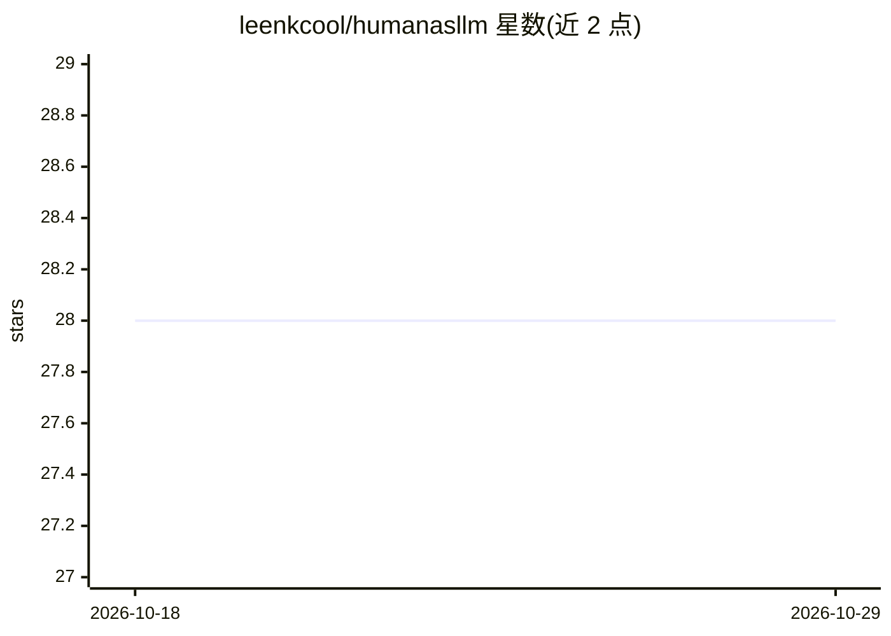

# leenkcool/humanasllm

⭐ 28 · JavaScript · MIT · 推送 2026-09-16 · [GitHub](https://github.com/leenkcool/humanasllm) · [官网](https://humanasllm.anytd.com/landing/) · 个人维护 · 中文 README

**Human-as-LLM 人工代理网关：把工程师接入 Agent 调度池**

OpenAI 兼容的 /v1 网关，把真实工程师作为「human-llm」模型路由接入多模型 Agent 调度池：涉密/运维/需人工判断的任务派发给人工工程师，完成后按大模型格式返回。核心机制包括异步受理（task_id/回调/SSE）、tools 函数调用、分级治理引擎（涉密白名单禁 AI 兜底）、审批流、审计哈希链与多租户隔离。Node.js 实现，依赖 PostgreSQL，支持私有化部署，另提供在线演示平台。Roadmap 中 Docker 部署、SSO 等尚未交付。

## 筛选速览

| 维度 | 判定 | 备注 |
|---|---|---|
| AI 角色 | `ai-ecosystem` | LLM/agent 周边工具 |
| 许可风险 | `permissive` | MIT |
| 部署形态 | `library` | 以包/库形式分发 |
| 模型依赖 | — | README 未给出锁定关系 |
| 硬件要求 | — | 无带数字的原话,不猜 |
| 安装摩擦 | `low` | 无编译、无系统依赖或容器化 |
| 成熟度 | — | 结构信号不足 |

## 能力要点

- OpenAI 兼容 /v1/chat/completions 与 /v1/approvals 接口，零代码接入调度池
- 分级治理：涉密/运维白名单锁死、禁 AI 兜底、审计哈希链与合规报告
- 为 13 种 AI Agent 工具（Claude Code/Cursor 等）生成 SKILL/AGENT 配置
- 异步受理三种取回方式：轮询、callback 回调、SSE 状态推送

## 适用场景

- 我的 Agent 遇到涉密或需人工判断的任务，路由给真人工程师处理
- 团队在内网私有化部署人工路由网关并保留审计合规留痕
- 通过演示平台体验任务队列、审批与多租户隔离

## 场景标签

`模型网关` `Agent 框架` · 领域:Agent 开发

## 证据(README 行号)

> L5: 让工程师作为「人肉大模型」接入多模型 Agent 调度框架。对外完全兼容 **OpenAI 标准接口**（`/v1`），调度池新增一条 `human-llm` 模型路由即可接入，**零代码改动**。涉密/私有/需人工判断的任务经此路
> L11: - **OpenAI 兼容**：`/v1/chat/completions`（一次性 + SSE 流式）+ `/v1/approvals`（AI 提审批）。**异步受理**：立即返回 `task_id`；三种取回方式——`GET 
> L42: |**Model Routing / LLM Gateway**|coai / ClawRouter / semantic-router|Human as LLM 即网关：路由目标可以是「人」；分级引擎 = 治理版语义路由|

## 星数曲线

2026-10-18 28 → 2026-10-29 28（+0）

---
*卡片 v1 · prompt 1.4 · 生成 2026-10-26 · 置信度 high · 依据 README sha `e8b7ef2c84ac` · [字段定义](../../DATASET.md)*
