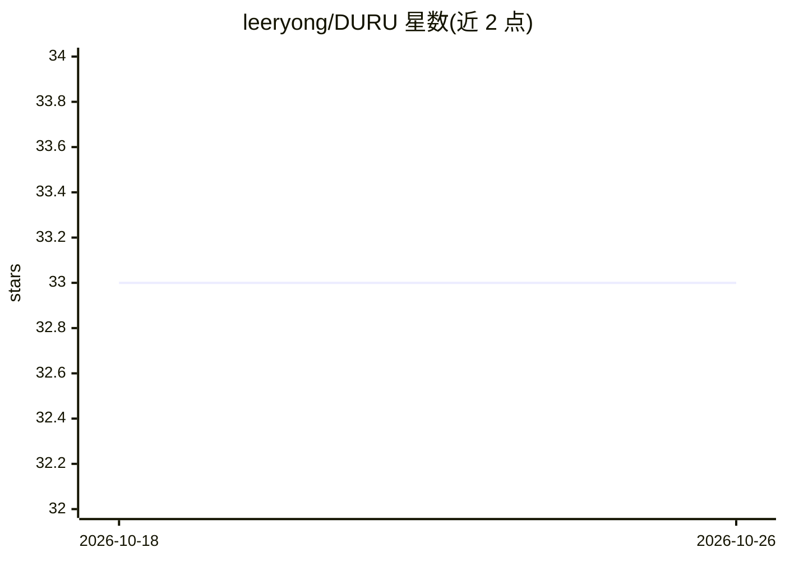

# leeryong/DURU

⭐ 33 · 推送 2026-09-07 · [GitHub](https://github.com/leeryong/DURU) · 组织维护

**本地 PC 文档问答 AI 代理：基于自己的文档生成附带出处的回答**

安装于个人电脑的本地 AI 代理程序：将 PDF·HWP·DOCX·PPTX·XLSX·TXT 等文档构建为知识库，在无外部服务器、外部 RAG、外部 LLM 的条件下于本机完成问答、摘要与分析，回答附带文档名与页码的依据并可跳转原文位置。通过 Ollama 运行本地小模型，确认支持 Solar、EXAONE 联动，可在断网内网（网络隔离）环境使用。提供 5 个角色代理，知识库（.durukb）与代理（.duruagent）可加密为文件分发，支持只读权限与完整性校验。注意：安装版分发、源码不公开。

## 筛选速览

| 维度 | 判定 | 备注 |
|---|---|---|
| AI 角色 | `ai-native` | 本体是模型或模型工具 |
| 许可风险 | `none` | — |
| 部署形态 | `desktop` | 安装包/桌面程序 |
| 模型依赖 | local-ok | 支持本地模型 |
| 硬件要求 | — | 无带数字的原话,不猜 |
| 安装摩擦 | `low` | 无编译、无系统依赖或容器化 |
| 成熟度 | — | 结构信号不足 |

## 能力要点

- 回答附带文档名·页码依据，点击跳转至原文对应位置
- Ollama 本地模型运行，首次启动自动安装并按 GPU·内存选择对话模型
- 知识库（.durukb）与代理（.duruagent）可加密、设只读权限后以文件分发
- 网络隔离内网环境可用，文档与模型均留在本机

## 适用场景

- 在断网内网环境下对规章制度、论文、教材提问并获得带出处的回答
- 负责人一次性构建知识库后，成员导入文件即可直接检索
- 用教材知识库让学习代理出题、批改并依据原文讲解

## 场景标签

`文档问答` · 领域:知识与检索

## 证据(README 行号)

> L32: DURU는 **내가 가진 문서를 근거로 답하는 AI**입니다.
> L35: - 📄 **내 문서에서 답을 찾습니다** — 규정집·논문·교재를 넣어 두면, 질문할 때 그 안에서 근거를 찾아 **어느 문서 몇 쪽인지** 함께 알려 줍니다.
> L171: AI 모델도 밖에 두지 않습니다. **Ollama**로 PC에 설치할 수 있는 소형 모델을 쓰며,

## 星数曲线

2026-10-18 33 → 2026-10-26 33（+0）

---
*卡片 v1 · prompt 1.4 · 生成 2026-10-25 · 置信度 high · 依据 README sha `49332ca03b82` · [字段定义](../../DATASET.md)*
