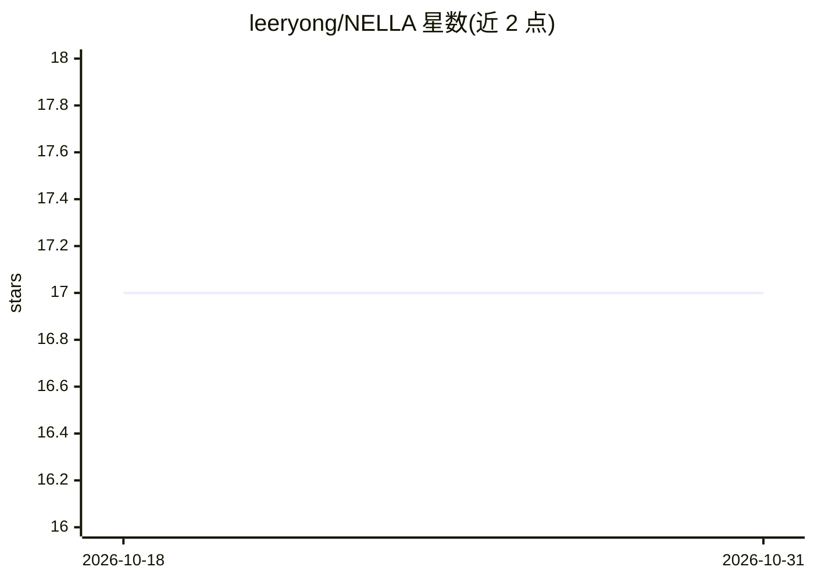

# leeryong/NELLA

⭐ 17 · TypeScript · 推送 2026-08-24 · [GitHub](https://github.com/leeryong/NELLA) · 组织维护 · 中文 README

**对话式 LLMOps 智能体：从文档自动生成数据、训练并评估领域 LLM**

本地安装的 Agentic LLMOps 程序：用户上传 PDF/DOCX/HWP 文档并用自然语言下达指令，智能体自动执行 10 阶段流水线——学习数据自动合成与质量校验、HuggingFace 基础模型检索与推荐（Scout 预验证）、LoRA/QLoRA 超参数自动调整与 SFT/DPO 训练、BLEU/ROUGE/LLM Judge 评估、ChromaDB RAG 库构建与对话测试；每阶段需用户批准（Human-in-the-Loop）。面向研究人员、机构负责人与教育场景。需 OpenAI/Anthropic API 密钥，GPU 训练从 8GB VRAM 起，提供 Windows 安装包与 Docker 两种部署方式。

## 筛选速览

| 维度 | 判定 | 备注 |
|---|---|---|
| AI 角色 | `ai-ecosystem` | LLM/agent 周边工具 |
| 许可风险 | `none` | — |
| 部署形态 | `desktop` | 安装包/桌面程序 |
| 模型依赖 | — | README 未给出锁定关系 |
| 硬件要求 | `gpu-8g` | |
| 安装摩擦 | `low` | 无编译、无系统依赖或容器化 |
| 成熟度 | — | 结构信号不足 |

## 能力要点

- 自然语言指令驱动 10 阶段 LLMOps 流水线自动执行
- 文档自动合成 SFT/DPO 训练数据并做质量校验
- 基础模型检索推荐与 Scout 训练效果预验证
- RAG 库（ChromaDB）构建与 Human-in-the-Loop 阶段审批

## 适用场景

- 把论文、实验资料训练成资料检索与摘要专用模型
- 机构内网部署了解内部规定与手册的业务助手
- 教学中实践 LLMOps 训练-评估全流程

## 场景标签

`微调` `RAG` `MLOps` · 领域:知识与检索

## 证据(README 行号)

> L141: - **자연어 기반 파이프라인 오케스트레이션**: 사용자의 목적을 분석해 10단계 LLMOps 파이프라인을 자동 계획하고 단계별 실행
> L124: |**6. 모델 훈련**|SFT·DPO·AutoResearch 파인튜닝|실제로 **공부시킵니다**|

## 星数曲线

2026-10-18 17 → 2026-10-31 17（+0）

---
*卡片 v1 · prompt 1.4 · 生成 2026-10-29 · 置信度 high · 依据 README sha `21b911eaa5ea` · [字段定义](../../DATASET.md)*
