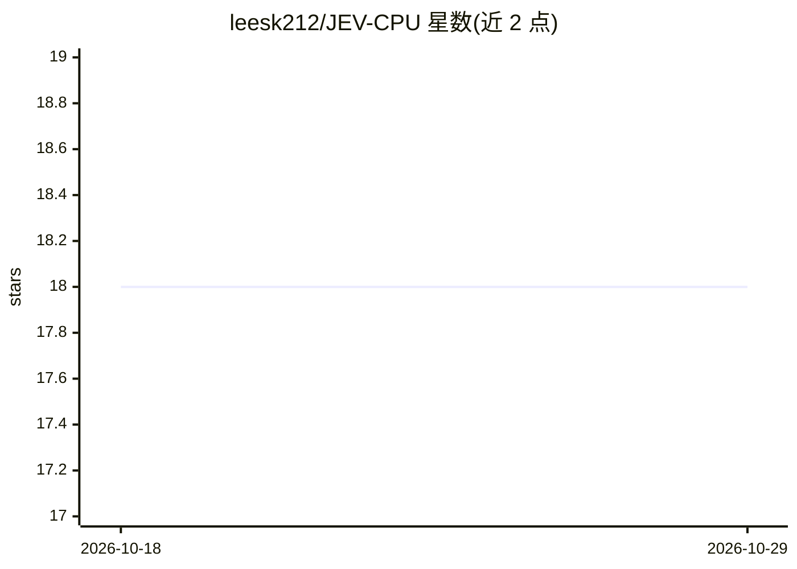

# leesk212/JEV-CPU

⭐ 18 · Python · MIT · 推送 2026-09-19 · [GitHub](https://github.com/leesk212/JEV-CPU) · [官网](https://leesk212.github.io/JEV-CPU/) · 个人维护

**在纯 CPU 上运行 SemIf 语义决策引擎，附 Web UI**

SemIf（原 OpenJev）的 CPU 适配版：将路由、审核、分诊等决策转成选项字母选择题，通过一次前向传播直接读取选项 token 的 logits 并做 softmax，得到各选项概率与胜出项，不做文本生成。默认加载 Qwen3-0.6B（float32，约 2.4 GB），单次决策约 1 秒，附标准库实现的 8080 端口 Web UI 与 HTTP API。给想在无 GPU 机器上试用该模式的开发者；换更大模型可提精度但受 CPU prefill 延迟限制（实用上限约 7,700 token 输入）。

## 筛选速览

| 维度 | 判定 | 备注 |
|---|---|---|
| AI 角色 | `ai-native` | 本体是模型或模型工具 |
| 许可风险 | `permissive` | MIT |
| 部署形态 | `library` | 以包/库形式分发 |
| 模型依赖 | — | README 未给出锁定关系 |
| 硬件要求 | `cpu-ok` | |
| 安装摩擦 | `medium` | 含编译或系统依赖之一 |
| 成熟度 | — | 结构信号不足 |

## 能力要点

- 一次前向传播读取选项 logits，无解码循环，CPU 单决策约 1 秒
- 默认 Qwen3-0.6B float32（约 2.4 GB），模型可一行切换
- 依赖标准库的 Web UI（端口 8080）与 /api/decide HTTP API
- shared 模式：一次 prefill 复用 KV cache 批量评估多准则

## 适用场景

- 在无 GPU 的笔记本上试用 SemIf 式语义决策
- 客服路由、内容审核、事故分级等八类域的零样本决策
- 通过 Web UI 运行时定义准则与选项做快速判定

## 场景标签

 · 领域:LLM 决策/零样本分类

## 证据(README 行号)

> L20: Most agent decisions are small: *route this*, *retry that*, *does the evidence support X?* SemIf answers them by re
> L52: - **Decision-native:** one forward pass reads declared option logits; no answer token is sampled.
> L57: This is the core idea, and it is why decisions are fast and cheap on a CPU: **the model never generates the answer 

## 星数曲线

2026-10-18 18 → 2026-10-29 18（+0）

---
*卡片 v1 · prompt 1.4 · 生成 2026-10-29 · 置信度 mid · 依据 README sha `b05dbf50ce7b` · [字段定义](../../DATASET.md)*
