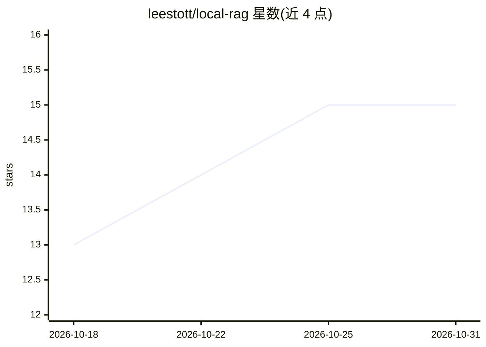

# leestott/local-rag

⭐ 15 · HTML · MIT · 推送 2026-03-13 · [GitHub](https://github.com/leestott/local-rag) · 个人维护

**气田工程师的离线 RAG 技术支持问答代理示例应用**

基于 Foundry Local 与 Phi-3.5 Mini 的完全离线 RAG 应用，面向气田巡检与维护工程师，浏览器提问后经 Express 服务器在 SQLite 向量库中做 TF-IDF 余弦检索，将命中的文档片段注入提示词，由本地 Phi-3.5 Mini 生成安全优先的回答，经 SSE 流式返回。检索无需嵌入模型与外部向量数据库，文档以约 200 token 滑窗（25 token 重叠）分块。运行需 Node.js≥20 与 Foundry Local，模型约 2GB 首次自动下载；附带 20 篇气工程文档与移动端适配 UI。

## 筛选速览

| 维度 | 判定 | 备注 |
|---|---|---|
| AI 角色 | `ai-native` | 本体是模型或模型工具 |
| 许可风险 | `permissive` | MIT |
| 部署形态 | `None` |  |
| 模型依赖 | — | README 未给出锁定关系 |
| 硬件要求 | `cpu-ok` | |
| 安装摩擦 | `low` | 无编译、无系统依赖或容器化 |
| 成熟度 | — | 结构信号不足 |

## 能力要点

- 100% 离线运行：无云、无 API key、无外呼
- SQLite + TF-IDF 检索，无需嵌入模型与外部向量库
- 约 200 token/25 token 重叠的固定滑窗分块策略
- 运行时上传 .md/.txt 文档即时索引，含 Edge 精简模式

## 适用场景

- 在现场离线设备上查询气田安全与检修规程
- 开发者学习端到端本地 RAG 应用构建模式
- 在弱配置 CPU/NPU 设备上运行领域问答代理

## 场景标签

`RAG` `文档问答` · 领域:知识与检索

## 证据(README 行号)

> L10: A fully offline, on-device **Retrieval-Augmented Generation (RAG)** support agent for gas field inspection and main
> L37: 4. Foundry Local generates a response using Phi-3.5 Mini, grounded in the retrieved context
> L44: - **RAG retrieval** – answers grounded in local gas engineering documents

## 星数曲线

2026-10-18 13 → 2026-10-31 15（+2）

---
*卡片 v1 · prompt 1.4 · 生成 2026-10-30 · 置信度 high · 依据 README sha `5f5c38e45b06` · [字段定义](../../DATASET.md)*
