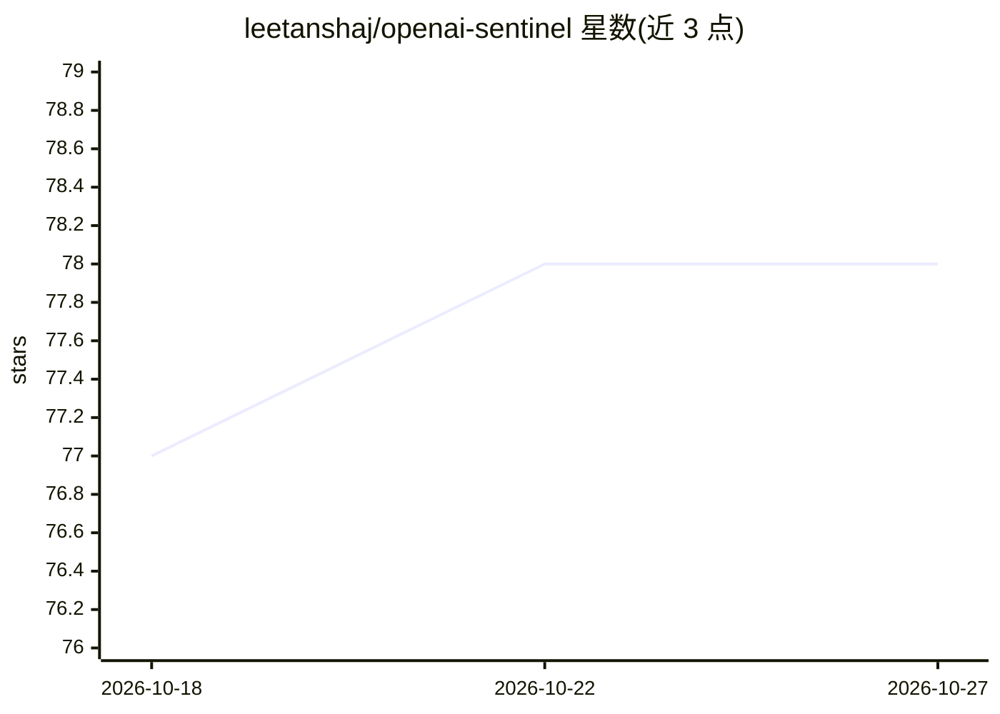

# leetanshaj/openai-sentinel

⭐ 78 · Python · 推送 2025-11-13 · [GitHub](https://github.com/leetanshaj/openai-sentinel) · 个人维护

**为开发者生成 ChatGPT/Sora 私有 API 的 PoW 与 Sentinel 令牌**

Python 实现，通过逆向浏览器令牌生成流程，为 OpenAI 的 ChatGPT 与 Sora 私有 API 生成 Proof of Work 令牌与 Sentinel 令牌，使程序化访问成为可能，无需浏览器手动交互。PoW 部分用 sha3_512 哈希迭代求解难度挑战并 base64 编码输出；Sentinel 部分先取 API 要求再构造令牌。配置项含 user agent、navigator keys 可自定义。声明仅供教育与研究用途，绕过安全机制可能违反 OpenAI 服务条款。需 Python 3.8+，git clone 后 pip 安装依赖，直接运行两个脚本即输出令牌。

## 筛选速览

| 维度 | 判定 | 备注 |
|---|---|---|
| AI 角色 | `ai-ecosystem` | LLM/agent 周边工具 |
| 许可风险 | `none` | — |
| 部署形态 | `library` | 以包/库形式分发 |
| 模型依赖 | — | README 未给出锁定关系 |
| 硬件要求 | — | 无带数字的原话,不猜 |
| 安装摩擦 | `low` | 无编译、无系统依赖或容器化 |
| 成熟度 | — | 结构信号不足 |

## 能力要点

- 实现基于 sha3_512 哈希迭代的 PoW 令牌生成
- 生成 API 认证所需 Sentinel 令牌（解析 turnstile/token 等字段）
- 可配置 user agent、navigator keys 等浏览器环境参数

## 适用场景

- 自动化脚本中程序化访问 ChatGPT/Sora 私有 API
- 对 OpenAI 安全机制做逆向研究
- API 自动化测试场景中替代浏览器手动生成令牌

## 场景标签

 · 领域:API 工具/逆向工程

## 证据(README 行号)

> L3: This repository provides a Python-based implementation to generate **Proof of Work (PoW) tokens** and **Sentinel tok
> L11: This project reverse-engineers the token generation process to allow developers to programmatically generate these 

## 星数曲线

2026-10-18 77 → 2026-10-27 78（+1）

---
*卡片 v1 · prompt 1.4 · 生成 2026-10-24 · 置信度 mid · 依据 README sha `71971783e844` · [字段定义](../../DATASET.md)*
