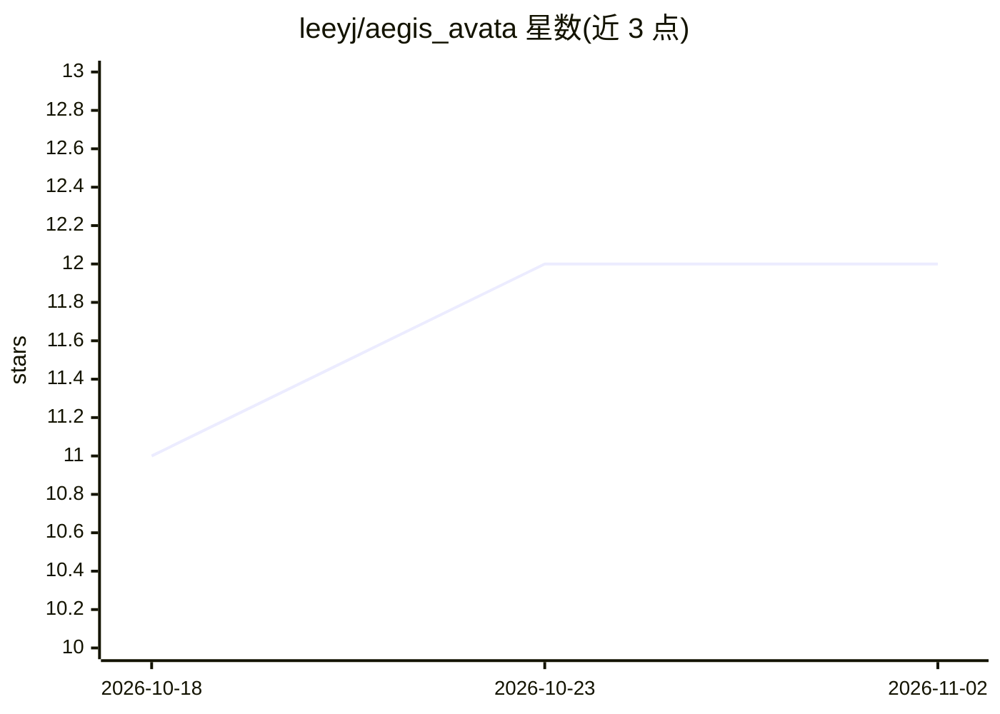

# leeyj/aegis_avata

⭐ 12 · Python · 推送 2026-03-16 · [GitHub](https://github.com/leeyj/aegis_avata) · 个人维护 · 中文 README

**带 Live2D 虚拟形象的 Gemini 个人 AI 助手仪表盘**

基于 Python 3.10+ 的实时个人助理仪表盘：聚合天气、新闻、Google 日历/任务/Gmail、金融指数与股票、系统资源等数据，由 Gemini 生成早晚语音简报，通过 Live2D 二维形象做视觉与语音交互（口型同步、数据驱动的表情动作）。v4.0 采用插件化架构，提供终端 HUD、Discord 机器人、Notion 知识库联动、YouTube Music BGM 与规则引擎（reactions.json）。安装需 git clone 源码、配置多份 API key（Google OAuth、OpenWeatherMap、Gemini、Notion），并自行下载 Live2D 模型放入 models/ 目录。部分功能（Studio 保存、别名自动生成等）仅对赞助者开放。

## 筛选速览

| 维度 | 判定 | 备注 |
|---|---|---|
| AI 角色 | `ai-native` | 本体是模型或模型工具 |
| 许可风险 | `none` | — |
| 部署形态 | `library` | 以包/库形式分发 |
| 模型依赖 | local-ok | 支持本地模型 |
| 硬件要求 | — | 无带数字的原话,不猜 |
| 安装摩擦 | `low` | 无编译、无系统依赖或容器化 |
| 成熟度 | — | 结构信号不足 |

## 能力要点

- Gemini 驱动的早晚语音简报与主动阈值告警（股价波动、临近日程等）
- Live2D 形象随数据变化联动表情动作，支持自定义别名与规则引擎编程
- v4.0 Plugin-X 插件架构，可用 AI 代理按 PLUGIN_SPEC 生成插件
- 终端 HUD 前缀路由（/@ 混合、/ 本地、/# 纯搜索）与 Discord 通道统一命令体系

## 适用场景

- 每天早晚让虚拟形象语音播报日程、天气、股价与未读邮件
- 用 Discord 远程查日程、设提醒并与 AI 对话
- 通过 Notion 联动记录备忘并按规则自动整理知识库
- 开发者按插件规范为自己的 widget 扩展仪表盘功能

## 场景标签

`AI 助手` · 领域:对话与助手

## 证据(README 行号)

> L42: AEGIS(에이지스)는 AI(Gemini) 모델과 Edge-TTS를 결합하여 만든 실시간 지능형 개인 비서 대시보드입니다.
> L47: - **AI 스마트 브리핑**: 현재 수집된 모든 데이터를 바탕으로 AI(Gemini)가 상황에 맞는 아침/저녁 브리핑을 음성으로 진행.
> L118: - 접두사가 없으면 현재 선택된 탭의 AI 모델(Gemini, Ollama 등)에게 일반적인 프롬프트를 전송하여 자율 판단을 맡깁니다.

## 星数曲线

2026-10-18 11 → 2026-11-02 12（+1）

---
*卡片 v1 · prompt 1.4 · 生成 2026-11-01 · 置信度 mid · 依据 README sha `536a25fe1a58` · [字段定义](../../DATASET.md)*
