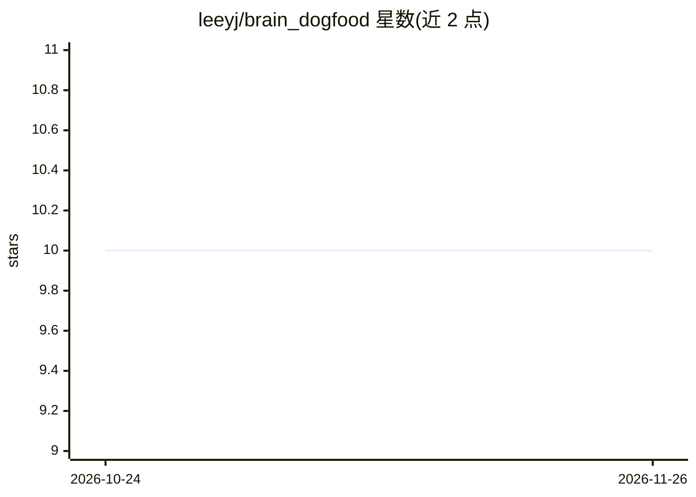

# leeyj/brain_dogfood

⭐ 10 · JavaScript · 推送 2026-11-13 · [GitHub](https://github.com/leeyj/brain_dogfood) · 个人维护

**自托管个人知识服务器，支持 AI 摘要/标签与知识图谱可视化**

Brain Dogfood 是一个自托管的个人知识管理服务器（Python 实现），提供备忘录、热力图、D3.js 知识图谱（Nebula）可视化、N:N 双向链接、可视连线与关系聚焦模式，并支持笔记级 AES-256 加密、加密 ZIP 备份与 Markdown 批量导出、离线解密工具。AI 功能为可选项：配置 Gemini API key 后启用自动摘要与 AI 标签，无 key 时核心功能均可运行。提供原生运行与 Docker 两种部署方式，通过浏览器访问。

## 筛选速览

| 维度 | 判定 | 备注 |
|---|---|---|
| AI 角色 | `ai-enhanced` | 去掉 AI 部分产品仍成立 |
| 许可风险 | `none` | — |
| 部署形态 | `self-host` | docker 或自建部署 |
| 模型依赖 | — | README 未给出锁定关系 |
| 硬件要求 | — | 无带数字的原话,不猜 |
| 安装摩擦 | `low` | 无编译、无系统依赖或容器化 |
| 成熟度 | — | 结构信号不足 |

## 能力要点

- D3.js 知识星图可视化与 Alt+拖拽可视连线、关系聚焦模式
- 笔记级 AES-256 加密，附加密 ZIP 备份与离线解密脚本（ex_tools/offline_exporter.py）
- 配置 GEMINI_API_KEY 后提供自动摘要与 AI 标签（可选功能）
- Slash 命令、快捷键体系与 Obsidian Markdown 导出

## 适用场景

- 自托管个人笔记与知识库，附带加密能力
- 用知识图谱可视化梳理笔记之间的关联
- 配置 Gemini key 后让笔记自动生成摘要与标签

## 场景标签

`知识库管理` `知识图谱` · 领域:知识与检索

## 证据(README 行号)

> L14: > **AI 기능은 선택 사항입니다 (AI is Optional)**
> L15: > - **Gemini API 키가 없어도** 뇌사료의 핵심 기능(기본 메모, 히트맵, 지식 그래프 Nebula, 개별 암호화 등)은 **모두 정상 작동**합니다.
> L16: > - AI 기능(`GEMINI_API_KEY`)은 자동 요약과 인공지능 태깅 기능을 사용할 때만 필요합니다.
> L164: > **AI is Optional**:

## 星数曲线

2026-10-24 10 → 2026-11-26 10（+0）

---
*卡片 v1 · prompt 1.4 · 生成 2026-11-19 · 置信度 high · 依据 README sha `58dd5f88142e` · [字段定义](../../DATASET.md)*
