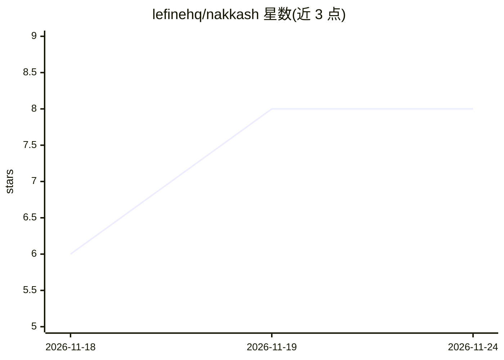

# lefinehq/nakkash

⭐ 9 · Rust · Apache-2.0 · 推送 2026-11-21 · [GitHub](https://github.com/lefinehq/nakkash) · 组织维护

**面向 agent 的可编程动态图形与视频渲染引擎**

以场景文件描述视频：用少量行声明内容与动效，引擎逐帧计算并本地渲染输出 H.264/HEVC/ProRes/AV1，无需浏览器或额外依赖。设计面向 AI agent：支持单行修改、以数字返回的检查结果，并写入面向 agent 的编写指南；`.aep` 项目与 `.mogrt` 模板可导入为场景（兼容性模式）。当前处于早期开发阶段，需从源码构建，使用 Rust 实现。

## 筛选速览

| 维度 | 判定 | 备注 |
|---|---|---|
| AI 角色 | `ai-native` | 本体是模型或模型工具 |
| 许可风险 | `permissive` | Apache-2.0 |
| 部署形态 | `None` |  |
| 模型依赖 | — | README 未给出锁定关系 |
| 硬件要求 | — | 无带数字的原话,不猜 |
| 安装摩擦 | `low` | 无编译、无系统依赖或容器化 |
| 成熟度 | `idea` | |

## 能力要点

- 场景即数据：场景文件描述视频，逐帧自动计算
- 原生渲染：浮点精度合成、真实运动模糊、多种编码直出
- 面向 agent：单行编辑、数值化检查、agent 编写指南
- `.aep` 与 `.mogrt` 导入为场景

## 适用场景

- 用场景文件程序化生成动态图形与短视频
- 让 AI agent 通过编辑场景文件迭代产出视频
- 导入 After Effects 项目与模板转为可编辑场景

## 场景标签

`视频生成` · 领域:内容生成

## 证据(README 行号)

> L3: **An open-source, AI-native engine for programmable motion graphics and video.**
> L10: - **Made for agents.** One-line edits, checks that answer in numbers, and no frames to look at.

## 星数曲线

2026-11-18 6 → 2026-11-24 8（+2）

---
*卡片 v1 · prompt 1.4 · 生成 2026-11-20 · 置信度 mid · 依据 README sha `865a98f3deb9` · [字段定义](../../DATASET.md)*
