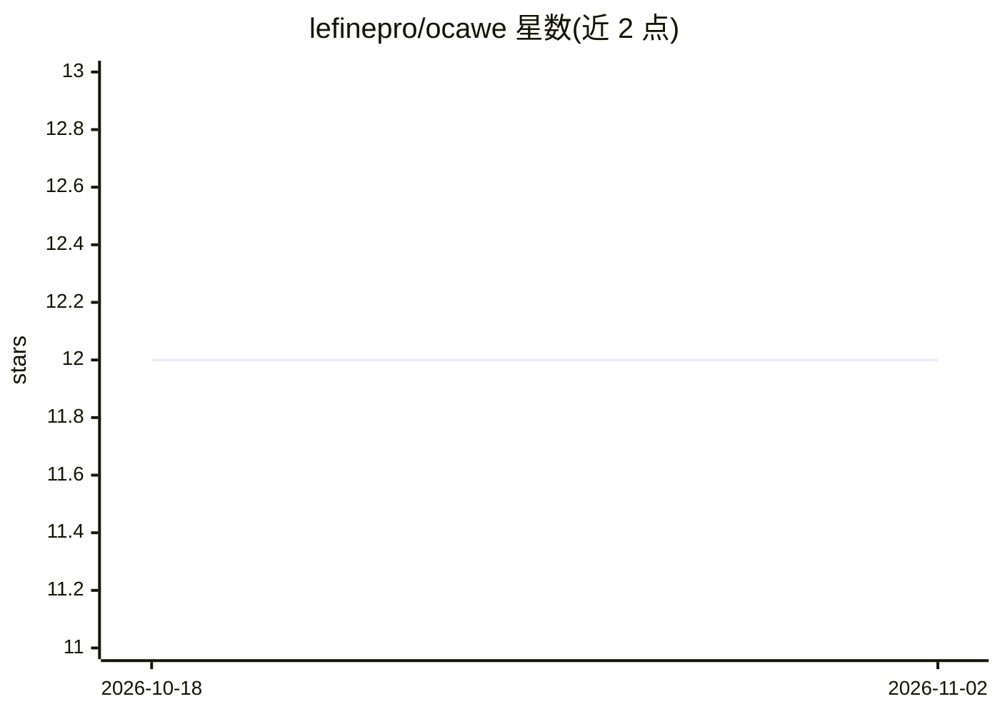

# lefinepro/ocawe

⭐ 12 · Crystal · 0BSD · 推送 2026-09-19 · [GitHub](https://github.com/lefinepro/ocawe) · 个人维护

**Crystal 编写的 agent 工作流框架与运行时**

以 Cawfile 工作流包为核心的 Crystal 框架与 HTTP 运行时：支持多工作流捆绑、@[Service] 常驻服务、agent/tool/skill 目录发现、语音与 RAG 模式、ACP 外部 agent 执行、schema 校验，并提供 OpenAI 兼容的 chat completions/responses 端点与 MCP、ActivityPub 联邦 API。附带 Svelte playground、VitePress 文档及 9 个示例（多 agent、控制流、RAG、语音管线等）。通过 Nix、GitHub Releases 安装脚本、mise 或源码构建安装，支持远程 nerdctl/docker/podman 构建。0BSD 许可。

## 筛选速览

| 维度 | 判定 | 备注 |
|---|---|---|
| AI 角色 | `ai-ecosystem` | LLM/agent 周边工具 |
| 许可风险 | `permissive` | 0BSD |
| 部署形态 | `library` | 以包/库形式分发 |
| 模型依赖 | — | README 未给出锁定关系 |
| 硬件要求 | — | 无带数字的原话,不猜 |
| 安装摩擦 | `low` | 无编译、无系统依赖或容器化 |
| 成熟度 | — | 结构信号不足 |

## 能力要点

- Cawfile 多工作流捆绑与 @[Service] 常驻服务模式
- OpenAI 兼容 chat completions/responses 端点与 MCP API
- ACP 执行外部 agent，ActivityPub 联邦远程 up
- Svelte playground 与 9 个功能示例（RAG、语音、控制流等）

## 适用场景

- 用 Cawfile 定义并运行多 agent 工作流管线
- 以 OpenAI 兼容端点触发本地 agent/skill/tool
- 远程打包并通过 ActivityPub 投递运行工作流

## 场景标签

`Agent 框架` `多智能体` `工作流自动化` · 领域:Agent 开发

## 证据(README 行号)

> L5: Ocawe is a Crystal-first framework and runtime for Cawfile workflow bundles,
> L28: - Universal ACP execution for external agents through =exec ..., runtime: {acp: {...}}=

## 星数曲线

2026-10-18 12 → 2026-11-02 12（+0）

---
*卡片 v1 · prompt 1.4 · 生成 2026-11-01 · 置信度 mid · 依据 README sha `89fa2601b6b5` · [字段定义](../../DATASET.md)*
