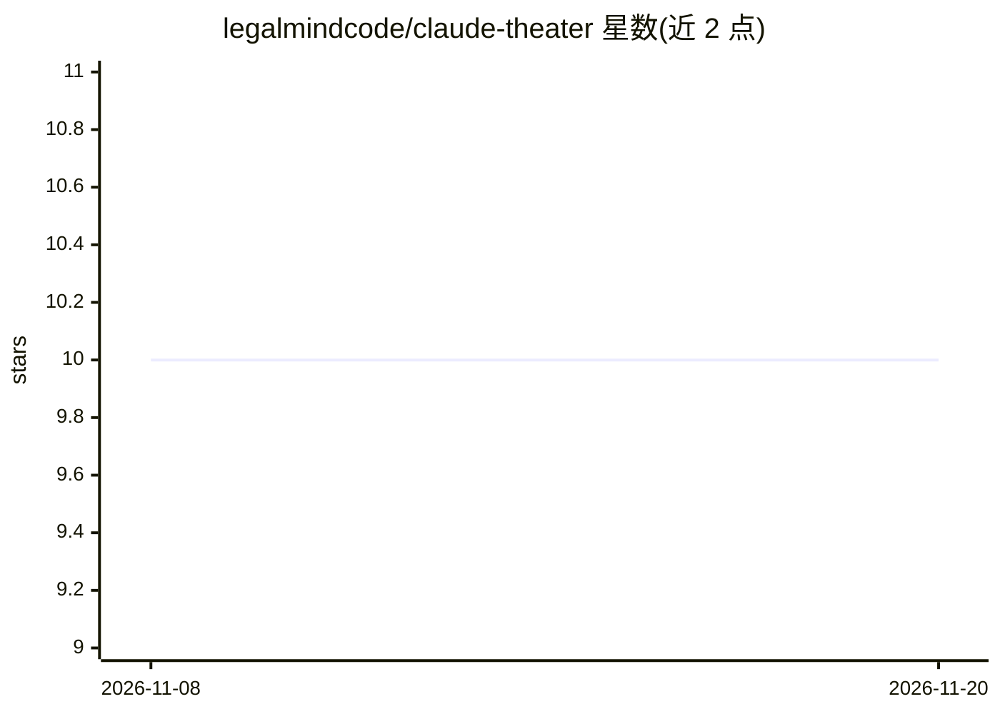

# legalmindcode/claude-theater

⭐ 10 · TypeScript · MIT · 推送 2026-11-16 · [GitHub](https://github.com/legalmindcode/claude-theater) · [官网](https://pypi.org/project/claude-theater/) · 个人维护

**实时可视化 Claude Code 子代理运行状态的插件**

以 Claude Code 插件形式运行，在 Claude 桌面应用 Code 标签页中绘制 Theater 面板：每个会话一张卡片，每个子代理一行，显示 persona、模型与状态，并提供 5 小时用量计量。通过轮询本地已有的会话转录文件工作，仅读取、不启动或控制代理，无网络调用与遥测。要求 Claude Code 2.1.304 以上，构建于早期访问的 function-hooks API，版本更新可能导致失效。支持希伯来语与英语界面。

## 筛选速览

| 维度 | 判定 | 备注 |
|---|---|---|
| AI 角色 | `ai-ecosystem` | LLM/agent 周边工具 |
| 许可风险 | `permissive` | MIT |
| 部署形态 | `None` |  |
| 模型依赖 | — | README 未给出锁定关系 |
| 硬件要求 | — | 无带数字的原话,不猜 |
| 安装摩擦 | `low` | 无编译、无系统依赖或容器化 |
| 成熟度 | `idea` | |

## 能力要点

- 每会话一卡、每子代理一行，实时显示 persona/模型/状态
- 轮询本地 Claude Code 转录文件，仅读取、无网络调用与遥测
- 5 小时用量计量，80%/95% 阈值提醒
- 支持终端/VS Code/移动会话以文本卡片形式呈现

## 适用场景

- 并行派发多个 Claude Code 子代理时观察谁在工作、谁卡住
- 不读日志即可查看子代理任务与结果
- 跟踪 5 小时用量窗口避免中途触顶

## 场景标签

`LLM 可观测性` · 领域:评测与运维

## 证据(README 行号)

> L12: **Claude Theater is a Claude Code plugin (a "mod")** that draws a **🎭 Theater** pane
> L16: **Why?** When you fan out a handful of subagents, the terminal becomes a wall of
> L20: **Safe by design:** it runs entirely on your machine. It only *reads* your local

## 星数曲线

2026-11-08 10 → 2026-11-20 10（+0）

---
*卡片 v1 · prompt 1.4 · 生成 2026-11-19 · 置信度 high · 依据 README sha `d25d86f932fd` · [字段定义](../../DATASET.md)*
