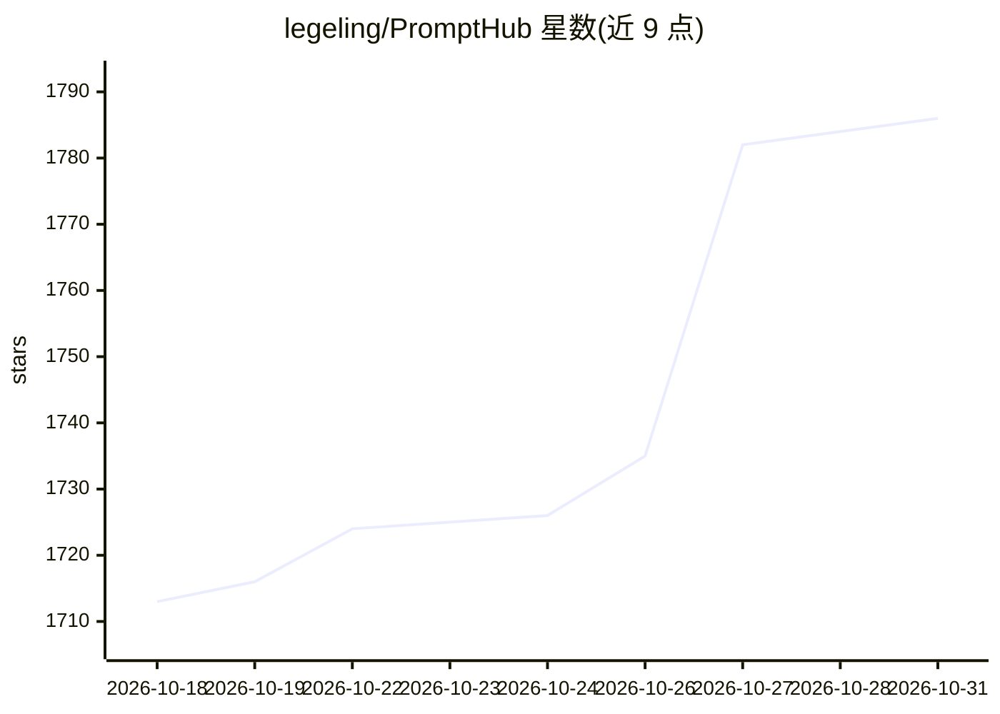

# legeling/PromptHub

⭐ 1,786 · TypeScript · AGPL-3.0 · 推送 2026-10-27 · [GitHub](https://github.com/legeling/PromptHub) · [官网](https://prompthub.click) · 个人维护 · 中文 README

**本地优先的 Prompt、Skill 与 Agent 资产管理桌面工作台**

基于 Electron/React/SQLite 的跨平台桌面应用，面向使用多个 AI 编程工具的用户：集中管理 Prompt、SKILL.md、Rules、MCP、Plugin 等资产，可把同一份 Skill 以 symlink 或 copy 方式一键分发到 Claude Code、Cursor、Codex 等 15+ 平台；提供 Prompt 模板变量、FTS5 全文搜索、版本历史与回滚、多模型 AI 测试与生成。数据默认存本地，支持 WebDAV/S3 同步、.phub.gz 备份与 Docker 自部署 Web 版，另有独立 CLI。

## 筛选速览

| 维度 | 判定 | 备注 |
|---|---|---|
| AI 角色 | `ai-ecosystem` | LLM/agent 周边工具 |
| 许可风险 | `viral` | AGPL-3.0 |
| 部署形态 | `self-host` | docker 或自建部署 |
| 模型依赖 | — | README 未给出锁定关系 |
| 硬件要求 | — | 无带数字的原话,不猜 |
| 安装摩擦 | `low` | 无编译、无系统依赖或容器化 |
| 成熟度 | — | 结构信号不足 |

## 能力要点

- Skill 一键分发到 15+ AI 编程平台（symlink/copy 双模式）
- Prompt/Skill/Rules 版本历史、差异对比与回滚
- 内置 20+ 精选技能的商店，可添加自定义商店源
- WebDAV/S3 同步与 Docker 自部署 Web 备份，数据本地优先

## 适用场景

- 在多个 AI 编程工具间统一管理和分发 Skills 与 Rules
- 给 Prompt 做版本管理并在多个模型上并行测试
- 通过 WebDAV 或自部署 Web 在多设备间同步 AI 资产

## 场景标签

`提示工程` · 领域:Agent 开发

## 证据(README 行号)

> L31: PromptHub 把你的 Prompt、SKILL.md 和项目级 AI 编程资产放进一个本地工作区。它能把同一份 Skill 一键安装到 Claude Code、Cursor、Codex、Windsurf、Antigravit
> L123: - **一键安装到平台**：Claude Code、Cursor、Windsurf、Codex、Antigravity、Kiro、Kilo Code、Cline、Qoder、QoderWork、CodeBuddy、Trae、Tr
> L147: - 内置 AI 测试，主流国内外服务商都能配（OpenAI、Anthropic、Gemini、Azure、自定义 endpoint 等）

## 星数曲线

2026-10-18 1,713 → 2026-10-31 1,786（+73）

---
*卡片 v1 · prompt 1.4 · 生成 2026-10-21 · 置信度 high · 依据 README sha `f91a6c812c89` · [字段定义](../../DATASET.md)*
