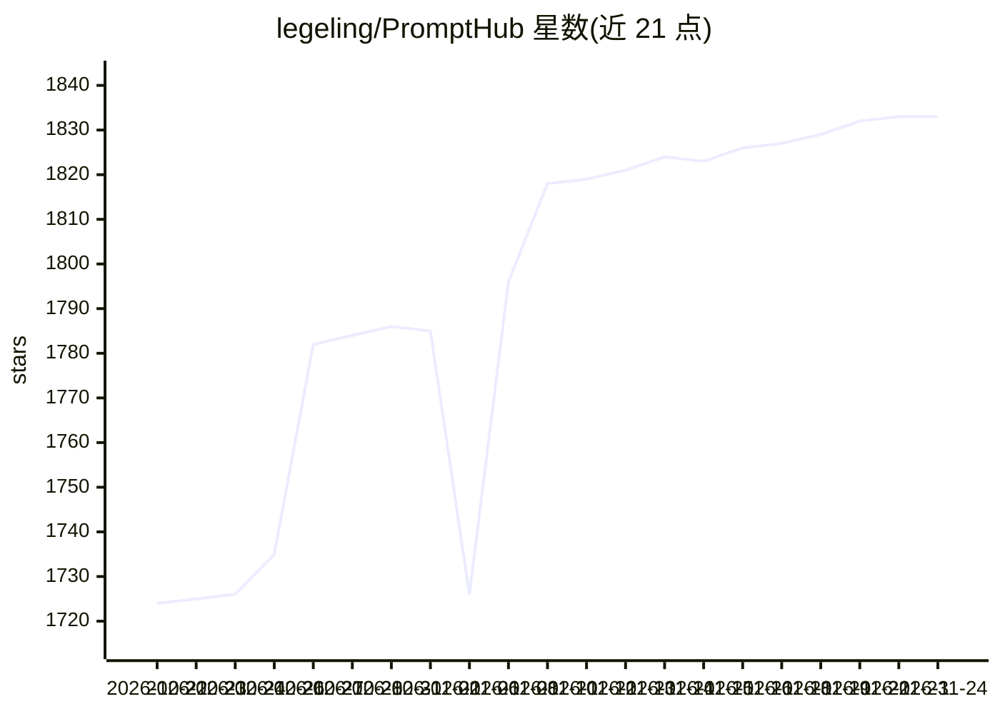

# legeling/PromptHub

⭐ 1,832 · TypeScript · AGPL-3.0 · 推送 2026-11-21 · [GitHub](https://github.com/legeling/PromptHub) · [官网](https://prompthub.click) · 个人维护 · 中文 README

**Prompt/Skill/Agent 资产的本地管理工作台，一键分发技能**

基于 Electron+SQLite 的本地优先工作台，集中管理 Prompt、SKILL.md、MCP、Plugin 和 AI 编程规则文件，支持把 Skill 按 symlink/copy 两种模式一键安装到 Claude Code、Cursor、Codex 等 15+ 工具目录。提供 Prompt 版本历史与回滚、多模型并行测试与 AI 生成草稿、WebDAV/S3 同步及自部署 Web 快照备份，附带独立 CLI 用于脚本化批量导入导出。桌面版覆盖 macOS/Windows/Linux。

## 筛选速览

| 维度 | 判定 | 备注 |
|---|---|---|
| AI 角色 | `ai-ecosystem` | LLM/agent 周边工具 |
| 许可风险 | `viral` | AGPL-3.0 |
| 部署形态 | `self-host` | docker 或自建部署 |
| 模型依赖 | — | README 未给出锁定关系 |
| 硬件要求 | — | 无带数字的原话,不猜 |
| 安装摩擦 | `low` | 无编译、无系统依赖或容器化 |
| 成熟度 | — | 结构信号不足 |

## 能力要点

- Skill 一键安装到 Claude Code、Cursor 等 15+ 平台，symlink/copy 双模式
- Prompt/Skill 版本历史、差异对比与一键回滚
- 本地优先存储，支持 WebDAV/S3 同步与自部署 Web 快照备份
- 多服务商端点管理，同一 Prompt 多模型并行对比测试

## 适用场景

- 集中管理散落在多个 AI 编程工具里的 Prompt 与 SKILL.md
- 把技能资产批量分发到多个 agent 工具目录
- 为 Prompt 建立版本控制与回滚机制
- 在 NAS/局域网自部署网页版做备份快照

## 场景标签

`提示工程` · 领域:Agent 开发

## 证据(README 行号)

> L5: 本地优先的 Prompt、Skill 与 AI 编程资产工作台。
> L31: PromptHub 把你的 Prompt、SKILL.md 和项目级 AI 编程资产放进一个本地工作区。它能把同一份 Skill 一键安装到 Claude Code、Cursor、Codex、Windsurf、Antigravit
> L125: - **一键安装到平台**：Claude Code、Cursor、Windsurf、Codex、Antigravity、Kiro、Kilo Code、Cline、Qoder、QoderWork、CodeBuddy、Trae、Tr

## 星数曲线

2026-10-22 1,724 → 2026-11-24 1,833（+109）

---
*卡片 v1 · prompt 1.4 · 生成 2026-11-23 · 置信度 high · 依据 README sha `ddb5e6cac986` · [字段定义](../../DATASET.md)*
