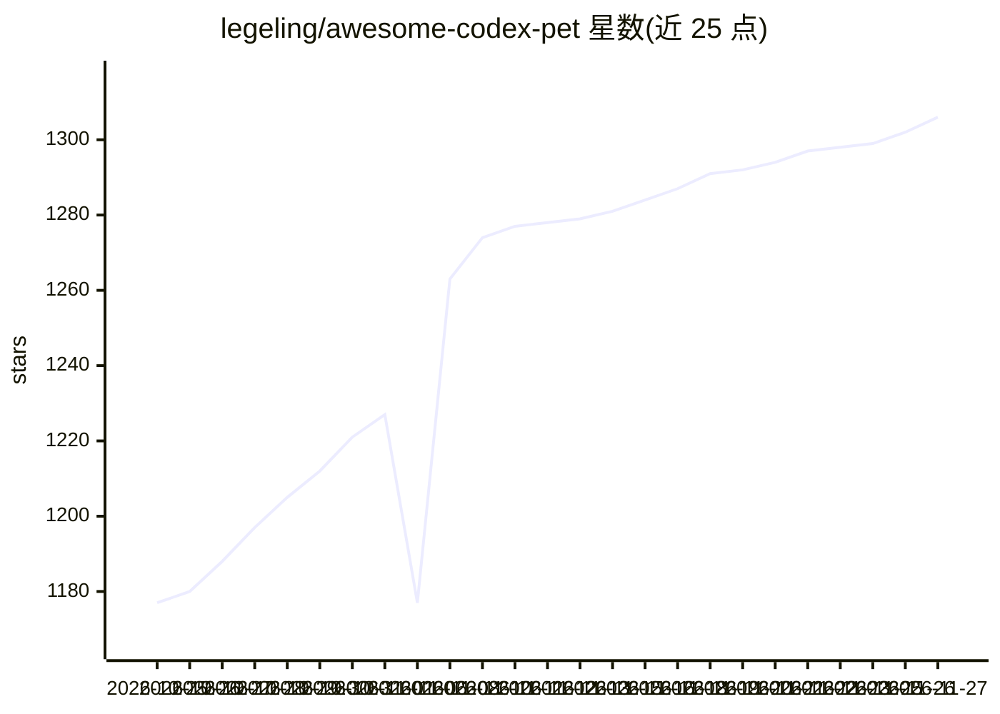

# legeling/awesome-codex-pet

⭐ 1,306 · TypeScript · MIT · 推送 2026-11-26 · [GitHub](https://github.com/legeling/awesome-codex-pet) · [官网](https://codexpet.top) · 个人维护 · 中文 README

**给 Codex 用户安装社区像素桌宠的画廊目录**

社区制作的 Codex 宠物资源目录，收录 386 个宠物、11 个分类（游戏角色/动漫角色/原创角色等），每个宠物以 pets/<slug>/ 目录打包（submission.json + pet.json + spritesheet.webp）。通过 npx @legeling/codex-pet 一条命令安装，无需克隆仓库；安装时校验清单与 SHA-256 哈希、先暂存后激活，默认写入 ~/.codex/pets/。宠物分 v1/v2 两版图集规格，v2 支持朝向观看动画；代码 MIT、素材 CC BY-NC 4.0。

## 筛选速览

| 维度 | 判定 | 备注 |
|---|---|---|
| AI 角色 | `ai-knowledge` | 知识聚合/清单类 |
| 许可风险 | `permissive` | MIT |
| 部署形态 | `library` | 以包/库形式分发 |
| 模型依赖 | — | README 未给出锁定关系 |
| 硬件要求 | — | 无带数字的原话,不猜 |
| 安装摩擦 | `low` | 无编译、无系统依赖或容器化 |
| 成熟度 | — | 结构信号不足 |

## 能力要点

- 386 个宠物、11 类目录，带动画预览与创作者署名
- npx 一条命令安装，跨 macOS/Linux/Windows，含哈希校验
- v2 图集规格支持 16 个朝向的观看动画
- 免费角色点单：提交角色由社区贡献者志愿制作

## 适用场景

- 为 Codex CLI 换一个喜欢的像素桌宠
- 不克隆仓库直接按宠物 ID 安装
- 提交新角色给社区贡献者志愿制作

## 场景标签

`精选清单` · 领域:学习与行业

## 证据(README 行号)

> L7:  Awesome Codex Pet is a free community pet gallery. Browse complete animations like a pet store, install a favorite 
> L13: pets: 386 categories: 11 languages: en | zh--CN | ko | ja | es code: MIT assets: CC BY--NC 4.0 install: one command
> L22: - **AI-first contributions** — contributors can create, repair, and submit pets with Codex; advanced contributors c

## 星数曲线

2026-10-25 1,177 → 2026-11-27 1,306（+129）

---
*卡片 v1 · prompt 1.4 · 生成 2026-11-23 · 置信度 mid · 依据 README sha `e085dea8a445` · [字段定义](../../DATASET.md)*
